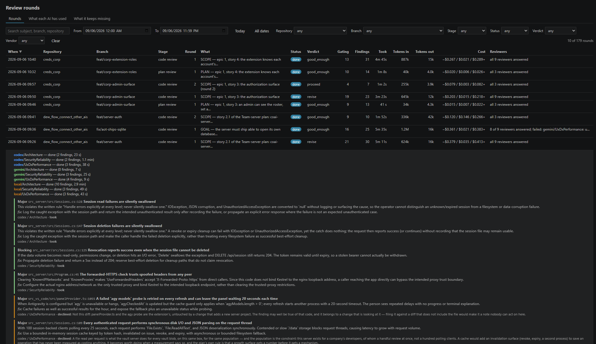
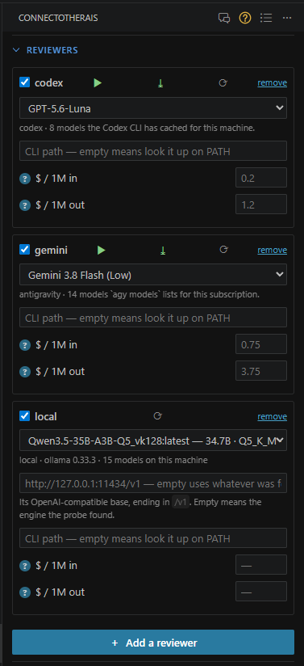
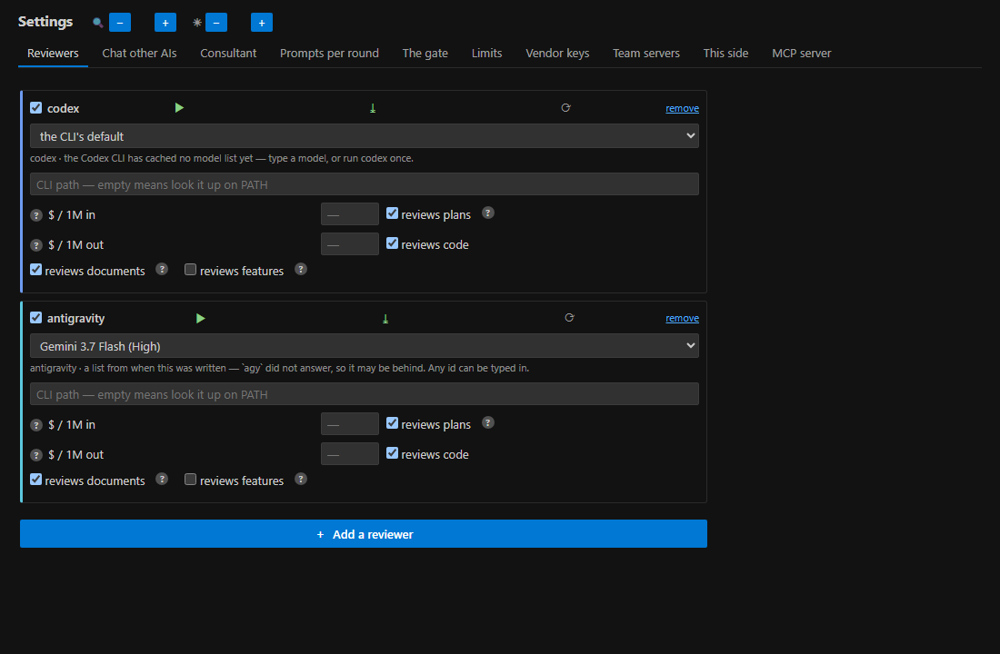
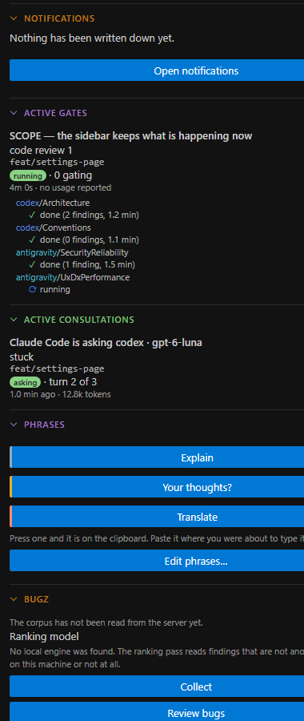
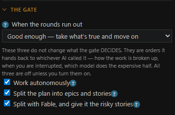
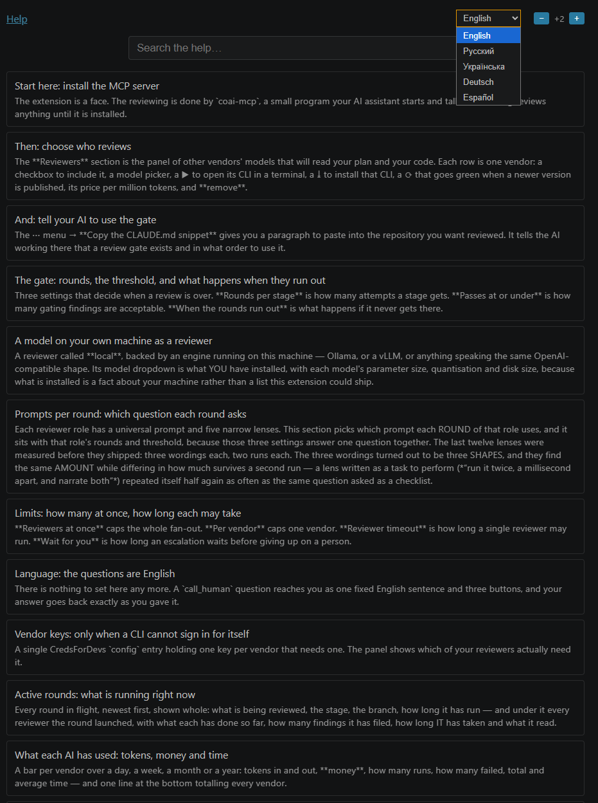

# ConnectOtherAIs

**Your coding agent cannot see its own assumptions. This puts the plan and the diff in front of
other vendors' models — before either reaches you.**

[](https://github.com/oleksandrdubyna88/dew_flow_connect_other_ais/actions/workflows/ci.yml)
[](https://marketplace.visualstudio.com/items?itemName=remsoftdev.connect-other-ais)
[](ARCHITECTURE.md)
[](#no-ports-nothing-listening)
[](LICENSE)

> **The value is not more review. It is review by a model that cannot see the author's reasoning —
> the only kind that catches the author's assumptions.**



*Every round, every finding, which vendor raised it, whether it was accepted or rejected and why —
and what it cost. That table is the product.*

## The problem

You already review your agent's work with your agent. It reads the diff it just wrote, with the
reasoning that produced it still in the context, and agrees with itself.

| Reviewing with one vendor | With ConnectOtherAIs |
|---|---|
| The model that wrote it also judges it | Other vendors read it with no memory of the reasoning that produced it |
| Formatting nits arrive as findings | Only `Blocking` and `Major` count toward the gate — [one line of code](src_mcp/core/Findings/Finding.cs) |
| Three bots raise one defect three times | Same file, lines within ±5, same remark → one finding ([`LineSlack = 5`](src_mcp/core/Gate/FindingDedup.cs)) |
| The whole repository in every prompt | The diff alone: **more** useful defects at two to three times fewer input tokens |

## What no other tool does

CodeRabbit, Greptile and Qodo review a **pull request** — after the code exists. Three things here
are different:

**1. The plan is gated before the code is written.** `review_code` is *refused* until a plan round
reached `proceed`. Skipping a stage is impossible, not discouraged:

```
open ─→ review_plan ─→ resolve ─→ (revise, repeat) ─→ PROCEED
                                                        │
   ┌────────────────────────────────────────────────────┘
   ▼
implement ─→ review_code ─→ resolve ─→ (fix, repeat) ─→ PROCEED ─→ ship
```

**2. It lives in your agent's loop, not in GitHub.** Claude Code, Cursor and Codex call it
themselves, over MCP, before a commit exists. Nothing to install into a repository, no bot on your
pull requests.

**3. It records the blind spots.** Every finding, and every accept and reject with its reason, in a
local SQLite database — grouped by category, by role and by vendor. Nobody else hands you the shape
of your own agent's blind spots.

## What the measurements say

Numbers from this repository's own campaigns, with their sample sizes, because a benchmark without
one is an advertisement:

**A second vendor is not a second opinion — it is different findings.** Fourteen judged runs, three
vendors, two cases: the overlap between vendors is **5–9 %**. Three reviewers reading the same diff
almost never name the same defect
([RESULTS_vendor_overlap_2026-09-06.md](research/RESULTS_vendor_overlap_2026-09-06.md)).

| provider | findings written | distinct | found by it alone (% of distinct) | of those, worth having |
|---|---|---|---|---|
| codex | 75 | 60 | 55 (92 %) | 22 |
| gemini | 52 | 43 | 39 (91 %) | 19 |
| local | 118 | 59 | 56 (95 %) | 5 |

**The diff alone beats the whole checkout.** Useful findings, and input tokens, on one commit with
three hosted models ([RESULTS_findings_that_are_worth_something.md](research/RESULTS_findings_that_are_worth_something.md)):

| model | with the checkout | diff only |
|---|---|---|
| Gemini 3.7 Flash | 4 · 610k tokens | **8** · 266k |
| GPT-5.6-Luna | 6 · 515k | **10** · 300k |
| Claude Sonnet 5 | 6 · 1 952k | **7** · 579k |

*One commit, three models, 19 findings — a single commit's worth of evidence, and it is why Fast is
the default rather than the only mode.*

**A local model earns its place per stage, not per repository.** The same judged campaign: `local`
was 19 % useful on a plan and **3 %** on code — it writes more than codex and gemini together, and
two of its seventy code-stage findings were worth having.

## Reviewers you can use



- **Codex CLI**, **Antigravity** (Gemini / Claude / GPT-OSS) — signed in as themselves, no API key.
- **Mistral Vibe** — Mistral's own CLI on your Mistral subscription, signed in as itself; added from
  the panel's *Add a model*, whose ⤓ runs Mistral's own installer for the side it is on. coai-mcp
  runs it on Windows only until Linux, WSL and macOS are measured, and needs coai-mcp 0.53.0.
- **Kimi Code** — Kimi's own CLI on your Kimi Code plan, signed in as itself (`kimi login`). coai-mcp runs it
  on Windows only, in a home of its own that reaches your sign-in by a link (your `~/.kimi-code` is never
  copied, edited or loaded for configuration), one review launch at a time. Added from the panel's *Add a model*,
  whose ⤓ runs Moonshot's own installer for the side it is on (on Windows it first installs Git, ripgrep and fd
  through winget when they are missing); needs coai-mcp 0.57.0.
- **A model on your own machine** — Ollama, vLLM, or **any OpenAI-compatible endpoint (DeepSeek,
  vLLM, Ollama)**. Called directly with a strict `json_schema`, not through a vendor CLI that spends
  20k tokens on a system prompt before it reads your diff.
- The model list is what *your* machine and *your* subscription actually have, asked for rather than
  shipped as a constant.

## <a id="no-ports-nothing-listening"></a>No ports, nothing listening

The server is a Native-AOT binary speaking MCP over **stdio**. State is atomic
files in a local state directory (v2 has no escalation cards: the gate never waits for a person). No daemon, no localhost port, no network listener on your machine.
(A company-wide *team server* is a separate, opt-in deployment — that one is an HTTP service behind
your own sign-in.)

## Quickstart

```bash
code --install-extension remsoftdev.connect-other-ais
```

1. **Install the server.** Command Palette → **ConnectOtherAIs: Install the MCP Server…** — it
   downloads the Native-AOT binary for your platform into the extension's own storage and copies a
   config block to your clipboard.
2. **Paste the block** into `~/.claude.json`, `.mcp.json` or `.vscode/mcp.json`:

   ```json
   {
     "mcpServers": {
       "coai": { "command": "/path/from/the/clipboard/coai-mcp", "args": [] }
     }
   }
   ```
3. **Tell your agent the gate exists.** Command Palette → **Copy the CLAUDE.md snippet**, paste it
   into `CLAUDE.md`, `AGENTS.md` or your rules file. That paragraph is what makes the agent call the
   gate on its own.
4. **Pick your reviewers** in the Settings tab — the gear in the panel's title bar — and set what happens
   when the rounds run out.



The sidebar keeps only what is happening now: the gates running, the consultations being had, where each
plan's consultation cadence stands, your phrases and the bug corpus.





Everything has a `?` beside it, and the help is a page of its own — in English, Russian, Ukrainian,
German and Spanish.



## Roles that run as jobs (v2)

Beside the review tools, `coai-mcp` can run a role on another model as a **detached job** that outlives the call, the server and your session:

- `start_role(role, repoPath, taskFile | brief)` starts it and answers at once with a `jobId`. Today: `ba` (plans an epic that has no stories into stories and tasks), `coder` (does one task in its own git worktree, below), `scout` and `judge` (read-only, below) and `probe` (a diagnostic).
- `role_status(jobId, maxSeconds?)` shows the state, the attempts (which model, why one stopped) and the result; `role_cancel(jobId)` stops the job.
- If a model hits a limit, refuses or crashes, the job moves to the next model of the role's list (`COAI_ROLES_MODELS`) at once, with one log line and one notice per switch.
- `review_plan(…, featureFolder, workItem?)` reviews a COMMITTED work-plan folder: the server reads it from git at the branch tip, validates it with this device's limits (an invalid one is refused with its first 10 errors before any round), packs the scope `workItem` names (the whole feature when none) in topological order, and records an approval id over everything the reviewers read; a coder job started under it is bound only when its task is inside the scope and nothing the reviewers read has changed since. The pack is at most 256 KiB (one file at most 64 KiB, the folder at most 2000 entries). Over a limit the round is refused with the size and the largest sections; nothing is cut.
- A role job runs claude on a **pool of keys**, never on your own sign-in: add each token from `claude setup-token` with `coai-mcp --keys add --label <name>` (the token is ONE line on stdin, never an argument). Jobs take the keys in turn; after a limit the same model runs again on the next key; with no usable key a job does not wait (another vendor runs, or it fails `limit`). A device with no key yet can set `COAI_ROLE_CLAUDE_PERSON_SIGN_IN=1`. The consultants and the gate reviewers do not use the pool.
- `validate_work(repoPath, featureFolder)` (or `coai-mcp --validate-work <dir>`) checks a work-plan tree; `coai-mcp --role-delta <jobId> --at <commit>` measures how much of a BA's task files the orchestrator changed (the plan passes below 20 %).

**The scout and the judge** (`start_role role: "scout"` or `"judge"`; no new tool) answer a question. They need `brief`, the question, and may add `taskFile`, the file it is about. Both are read-only (Read, Glob, Grep; no shell, no write tool) and answer ONE JSON object. The scout (the `scout` list of `COAI_ROLES_MODELS`) gives `facts`, each with `evidence` `{file, line, text}`, the `files` a reader needs, and what it did not find (`unknown`). The judge gives a `verdict` (`approve`, `revise`, `reject`), a `summary`, `findings` with the gate's four severity words and, when the brief asks to choose, a `decision`; it runs on the `important` list only (a `model` outside that list is refused) and writes no file. coai checks every evidence item against the file itself and says `verified` or not in the result; a blank evidence text and a path that leaves the repository are errors that go back to the model (two repair turns at most). The shapes are `shared/scout-output.schema.json` and `shared/judge-output.schema.json`.

**The coder** (`start_role role: "coder"`, `taskFile:` a `task.yaml` of a valid work plan; there is no `start_coder` tool) works on a model of claude, codex or agy in a git worktree `coder/<jobId>`. The coder edits files; coai commits, builds and tests. The checks are the repository's own, in `.coai/toolchain.yaml` (per project: `path`, `adapter`, `build` and `test` as an argv one item to a line, `memoryMb`; `skip`; `timeouts`). The file is read at the base commit, so a coder cannot change its own checks, and a repository with no file has no checks and is never green. A red check goes back to the SAME session of the same vendor (claude `--resume`, codex `exec resume`, agy `--conversation`) as a short failure digest, at most `COAI_FIX_ROUNDS` times (default 3, from 0 to 10). The result names the branch, the commit, the files that changed (from git, not from the coder's word) and whether the checks are green.

The coder can write its worktree and nothing else: fixed launch flags, and the CLI process and every build and test step run in a `systemd-run --user` unit. For claude the unit binds the main checkout read-only, and that layer stops writes, not reads. For codex and agy the unit HIDES the main checkout, the coder root and the folders of other jobs, and the job gets a COPY of the sign-in (codex: with a placeholder in place of the refresh token; agy: the access token only). It exists on Linux and WSL only: a coder job is refused on native Windows and on macOS before anything starts.

**What the boundary of codex and of agy is, and is not.** Which vendors can be a coder is decided by one file, `shared/coder-boundary-releases.json`: a verdict (`ship` or `refuse`), the mark `launchable`, and the history of the measures ("measured on which release, when"). Both vendors ship. **codex** was measured on `codex-cli 0.171.0` (2026-11-25 and 2026-11-26): the commands of the model run in the vendor's own sandbox, which is the one layer between a command and the sign-in copy. The codex process itself has the whole network, and the JavaScript the model writes runs outside that sandbox. **agy** was measured on `agy 1.5.18` (2026-11-26): the OS layer does not keep a command from the sign-in copy (an access token of about one hour). Only the agent file (three tools, no command tool), the guard (a hook that allows a write only inside the worktree) and the mode `accept-edits` keep a command from existing, and they rest on the behaviour of agy. The agy process has the whole network. An agy coder cannot edit `.git`, `.agents` or `.codex` of its worktree.

No version of the CLI of claude, codex or agy refuses or stops anything, and none asks for a new measure (the owner's decision of 2026-11-26): an older or a newer release runs like the measured one, and the result names the installed release beside the last measured one (`cli` in the result, `cliVersion` and `lastMeasuredVersion` in an attempt). What still refuses a coder asks the CLI what it does: the verdict, a flag that the help of the installed CLI does not declare, a preflight row (a probe with no model, in the exact launch unit), a launch check and a turn check on the stream of the CLI.

**The instruction step.** A repository can declare one command in the key `instructions` of `.coai/toolchain.yaml`. coai runs it once, before any model, and puts its output (at most 64 KiB) at the end of the prompt of every vendor under "Run by coai before your turn". A step that cannot run ends the job `instructions-failed` with no model launched. With no step, a codex or agy coder is told that nothing was run.

The design is in [ARCHITECTURE.md](ARCHITECTURE.md#role-jobs-and-the-ba-v2-epoch-3), [the coder](ARCHITECTURE.md#the-coder-v2-epoch-3) and [the key pool](ARCHITECTURE.md#the-claude-key-pool-v2-epoch-3).

## Security lane

The optional **Security lane** adds reviewer/prompt pairs beside ordinary code and feature reviews.
Every prompt is a card on Settings → Security lane, paired with a reviewer by a checkbox on the card:
`redteam-general` comes first and runs on every code change while it is paired, and the conditional presets —
authorization, SQL, concurrency, auth tokens, SSRF, webhooks, files, commands, deserialization, secrets,
prompt injection and XSS — run when changed code matches their conditions. A shipped card is green, one you
changed is orange with **Restore default**, and **+ New custom prompt** adds a purple one of your own.
Prompts are versioned under `src_mcp/src/prompts/redteam-*.md`; settings select when each runs
and how much committed source it receives. Findings keep reproduction evidence and their reviewer
identity in history. Missing lane answers are recorded explicitly. See
[the security lane module](research/module_security_lane.md) for configuration and limits.

## When the rounds run out

v2 has four outcomes and no choice to make. A round ends as `proceed`, `revise`, `good_enough` or
`not_reviewed`. The gate never holds, never waits for a person and never writes a card: a round nobody
answered proceeds as `not_reviewed` (never a pass; a feature review's first round is retried first), and
spent rounds proceed as `good_enough` — the agent applies what is true, rejects the rest *with reasons*,
and proceeds — each logged and noted on the round. Your AI may still ask you a question its consultants
could not settle, but it asks in its own chat: the `ask_human` tool only points it back there. The old
policies (**ask a human**, **continue anyway**, **escalate**) and the `COAI_ON_EXHAUSTED` setting are gone;
a data folder from an older build is converted by the first v2 start (`coai-mcp --migrate-v2` shows what
it would do). A rejection needs a reason, and a reasoned rejection is discounted in later rounds unless a
reviewer re-raises it with a genuinely new argument.

## Deeper

**Want the protocol as it is enforced, the prompt-shape measurements, the local-model path and the
token accounting? → [ARCHITECTURE.md](ARCHITECTURE.md).**

- [research/architecture.md](research/architecture.md) — the system as it is, module by module
- [research/module_tests.md](research/module_tests.md) — the harness, the flows it covers, and the
  gaps it does not
- [research/](research/) — every measurement campaign, with its raw data under `research/data/`
- [todo/](todo/) — what is planned and not yet built

## License

MIT.

## Developing with shared instructions

Initialize the committed rules version before building:

```sh
git submodule update --init .agents/conventions
npm ci --ignore-scripts --prefix .agents/conventions
node .agents/conventions/tools/rules.mjs check --repo .
npm ci --prefix src_vs_code
npm test --prefix src_vs_code
```

Node 22 is used in CI. Claude Code and Codex enter through AGENTS and the shared ENTRY;
project policy is in `.agents/PROJECT.md` and local rules in `.agents/rules`. Edit shared
policy in the conventions repository, then review and pin its commit here. The extension
prepares its gate text from that canonical source before compile/typecheck/bundle; missing,
dirty or mismatched sources stop the build. Generated delivery is ignored and never edited.
