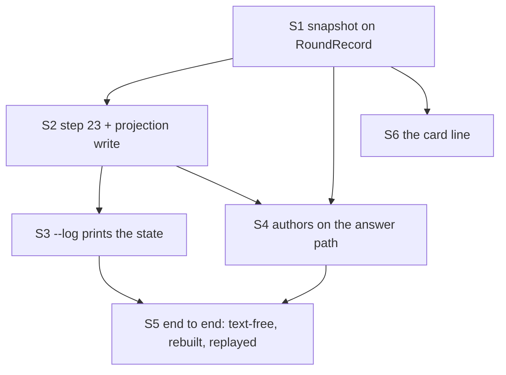

# PLAN — Round authors, epic E5: store and show

> Status: **plan only, nothing implemented yet, 2026-10-14.** Epic E5 of [PLAN_a_round_records_who_wrote_the_code_and_how_much.md](PLAN_a_round_records_who_wrote_the_code_and_how_much.md).
>
> Scope: parent §11 step 4. The round's authors as a nullable snapshot on `RoundRecord` (the session file), schema step 23 and
> its projection write, `--log`'s state, the reader and attribution run on the answer path under a 2 s / 64 MB budget, and one
> line on the round card. Six stories, S1–S6. **No cornerstone**: the parent names no area for E5 (`## Epics`, "E1, E5, E6, E7
> carry no area"); the parent's ledger reads `Cornerstones: 3 of 3 — E2.S1, E3.S4, E4.S2` (parent §16 D21).
>
> Related: [module_server.md](../research/module_server.md) (schema steps 20–21, the `asked by` line),
> [module_extension.md](../research/module_extension.md), [PLAN_the_round_knows_which_ai_called_it.md](../research/PLAN_the_round_knows_which_ai_called_it.md)
> (the `RoundRecord.Caller` twin every story here copies).

## 1. What E5 delivers, and the decision it is built on

After E5, every plan or code round the engine finishes carries **who wrote the code under review** — observed, partial or
unobserved, never guessed — in the session file AND in `coai.db`, and the Review rounds page shows one line for it.

**The decision (main session, 2026-10-14).** The authors are kept as a **nullable snapshot on `RoundRecord`**, like `Caller`
(`src_mcp/src/Server/SessionStore.cs:172-193`) and like E2's `Size`, not in the projection only: the database is a projection of
the session files (`src_mcp/src/Store/Schema.cs:7-10`, `src_mcp/src/Store/Projection.cs:7-10`), and a round whose transcript is
gone cannot be recovered by any backfill. The snapshot is text-free: ids, enumerated words, counts and tokens.

Three consequences every story obeys:

1. **The snapshot is computed BEFORE `_store.Save`** (`src_mcp/src/Server/Rounds/RoundEngine.cs:586-601`), inside the record's
   `with` block (`:483-491`) — which is also before `Projection.Write` opens the database (`:607`), the parent's condition.
2. **`RecordRound` projects it from `round`, never from `RoundContext`** — the rule `RoundContext`'s remarks state for `Caller`
   (`src_mcp/src/Store/RoundContext.cs:29-36`): one fact, one source. A rebuilt database must come back with the same rows.
3. **A null snapshot is "not recorded"** and is never normalised into a default (`SessionStore.cs:178-191` explains why a getter
   that materialised one would rewrite history on the next progress-tick save).

## 2. Dependencies on other epics

| Needs | From | Exactly what |
|---|---|---|
| Step 22 merged before step 23 | E2.S3 | `round_changes` + `reviewers.effort` appended after `TheRoundsKey` (`Schema.cs:31-37,614-616`); E5's step is numbered at merge time, after whatever is last on `main` |
| `RoundRecord.Size` and its JSON shape | E2.S3 (the member), E2 §4 C3 (the shape) | the card's size clause (S6) |
| The reader's entry point and states | E3.S2 (`ClaudeHome`, the locator, the test home), E3.S4 (`ObservedSession`, the budget, `fromUtc`) | resolve the caller session id (registry, then variable) and its source; read `<projects>/*/<sessionId>.jsonl` + subagents; return an `ObservedSession` with `observed` / `partial: <why>` / `unobserved: <why>`; a **budget seam** (time + bytes) and a **home-directory seam** (projects + session registry) — S4 widens E3's entry with one optional parameter if either is missing, never a second reader |
| The reader's version | E3.S4 (`ObservedSession.ReaderVersion`) | one integer that changes when a counting or association rule changes (`authors_reader`, parent §9); S1 adds the constant only if neither epic did |
| Attribution of ONE round | E4.S2 (windows, ladder), E4.S3 (rows, totals, state) | pure: `ObservedSession` + the gate session's rounds + `OpenedUtc` + `repo_path` + the peers and `PeersKnown` (§3 below) + the universe → per-window rows and the ambiguous and claimed-by-peer totals for THIS round; `ReadFrom` first, for E3's `fromUtc` |
| Sanitised fixtures with sentinels | E1.S5 (cut by E1.S3's tool) | S5's end-to-end inputs; their write paths must be re-pointable at a temp repository and their timestamps shiftable to "now" (§7, defect 13) |

## 3. Decisions this document had to make (the parent is silent or inconsistent)

Each is a choice the main session may overrule before the story starts; §7 lists them as parent defects.

- **Which rounds.** `PlanReview` and `CodeReview` rounds finished by the engine get a snapshot. Skipped rounds
  (`src_mcp/src/Server/Rounds/RoundSkips.cs:79-80`) and every other stage (feature, document) get none — they read *not recorded*.
- **The peers** (E4.S2 §S2.8, which replaces this document's first "prior window end" decision). On EVERY round, not
  only the first: the gate sessions other than this one holding a round whose `rounds.authors_session` or `rounds.caller`
  equals this caller, found by one read-only query on the projection; each peer is then built as a `GateTimeline` from
  its SESSION FILE — `OpenedUtc` from `PersistedSession.OpenedUtc`, never `sessions.opened_utc` (parent §6), its
  journal from the file, `CompletedUtc` per round — with `CallerSessionId` per round from `rounds.authors_session`,
  else `rounds.caller` when it is a UUID, else `""`. E4 computes the `before-open` bound from them (`Windows.PriorEnd`).
  A store that cannot answer (absent, locked, older than step 23 → no column, a peer file unreadable) → `PeersKnown =
  false`, `Peers` empty, and every window `partial: prior windows unknown`. Step 23 indexes `rounds(authors_session)`.
- **The id source is persisted** (`authors_id_source`): parent §5 requires it, §11 step 4's column list omits it.
- **`open`/`status` do not carry the snapshot.** `SessionAnswerFor` sends `session.Rounds` to the calling AI on every reply
  (`src_mcp/src/Server/PanelService.cs:1814-1822`); the rows would cost the caller up to several KB of context per round. The
  answer strips `Authors` (null is omitted, `src_mcp/src/Server/ServerJsonContext.cs:339-344`); the file and the page keep it.
- **The card line describes THIS round's windows** (`before-open` + `round`), with the `delta` size when E2 recorded one and the
  `whole` size otherwise — so the authors and the size describe the same stretch of work. Contributors (the union over rounds,
  parent §6) are the report's (E6), not the card's: computing them in TypeScript would be a second implementation of E4.
- **A null snapshot never erases projection rows** — so E7's backfilled rows survive a re-record of the round (defect 9).

## 4. Order

S6 may run beside S2–S5 once S1 and E2 have merged. The epic ships as ONE commit on its own branch, the coai gate once (parent
`## Epics`); stories are review units inside it, not commits.

## 5. Stories

### E5.S1 — The snapshot on the round

- **Goal.** `RoundRecord` carries a nullable, text-free `Authors` snapshot that survives a save/load round trip; a session file
  written before it reads `null`; the `open`/`status` answer omits it.
- **Scope.**
  - New `src_mcp/src/Store/RoundAuthors.cs`: `RoundAuthors(State, Session, IdSource, Reader, Rows, Ambiguous)`; a row
    `AuthorRow(Who, Agent /* opaque agent id, "" for main — E4/8, accepted in parent §16 */, Requested, Model, Effort, AgentType, Association, Window, Launches, Turns, InputTokens, OutputTokens,
    CacheCreationTokens, CacheReadTokens, WriteCalls)` (parent §11 step 4's columns); `AuthorTotals` for the ambiguous totals;
    `SubmoduleWrites` and `UncoveredWrites` (ints, parent §7 — gate finding 0).
    `Rows` is normalised to `[]` inside the snapshot (an empty list and an absent one mean the same thing there); the snapshot
    itself is not. **If E4's per-round output already has this shape, persist E4's type — do not copy its fields into a twin.**
  - `RoundRecord.Authors { get; init; }` (`RoundAuthors?`) beside `Caller` (`SessionStore.cs:193`), with remarks naming the
    `Caller` precedent and this plan. No getter default.
  - `PanelService.cs:1821`: `Rounds = [.. session.Rounds.Select(r => r with { Authors = null })]` in `SessionAnswerFor`.
  - The reader-version constant only if E3/E4 have none (§2).
- **The brief.** Primary-constructor records; `WhenWritingNull` already omits a null snapshot. Nothing in this story reads a
  transcript or touches the database. ≤ 4 cyclomatic complexity per method.
- **Tests (RED first; `CoaiMcp.Tests.exe --filter-class "*RoundAuthorsSnapshot*"`):**
  - A round saved with an `observed` snapshot of three rows and ambiguous totals loads back equal, field for field.
  - A session file written by today's binary (no `authors` key) loads `Authors == null`, and saving it again writes no
    `authors` key — the precedent's failure mode, stated as a test.
  - `status` over a session whose round carries a snapshot has no `authors` key in its JSON; the session file still has it.
  - Break-it: give `Authors` a materialising getter (`field ??= new(...)`) → the second test goes red naming the invented key;
    restore. Break-it: remove the strip in `SessionAnswerFor` → the third goes red.
- **Done when.** Tests green; no change to any existing session-file test.
- **Depends on.** E4.S3 (its per-round output type, to reuse it), E2.S3 (`RoundRecord.Size`, the other trailing member).
- **Model.** Judge: opus (scenarios + brief) → Coder: sonnet → Judge: opus (review) → Coder: sonnet (fixes).

### E5.S2 — Schema step 23 and the projection write

- **Goal.** `coai.db` holds what the snapshot holds, written from `round` inside `RecordRound`'s transaction, and comes back
  identical from the session file after the database is deleted.
- **Scope.**
  - `Schema.cs`: a step `TheRoundsAuthors`, appended after E2's step (`Schema.cs:31-37`), numbered at merge time:
    `CREATE TABLE IF NOT EXISTS round_authors (round_id INTEGER NOT NULL REFERENCES rounds(id), ordinal INTEGER NOT NULL, who, agent,
    requested, model, effort, agent_type, association, window TEXT NOT NULL DEFAULT '', launches, turns, input_tokens,
    output_tokens, cache_creation_tokens, cache_read_tokens, write_calls INTEGER NOT NULL DEFAULT 0, PRIMARY KEY (round_id,
    ordinal))`; on `rounds`: `authors_state`, `authors_session`, `authors_id_source` (TEXT, default `''`), `authors_reader`
    (INTEGER, default 0), `submodule_writes`, `uncovered_writes` (INTEGER, default 0, meaningful only with a state), and `ambiguous_launches`, `ambiguous_turns`, `ambiguous_input_tokens`, `ambiguous_output_tokens`,
    `ambiguous_cache_creation_tokens`, `ambiguous_cache_read_tokens` (INTEGER, default 0); `CREATE INDEX IF NOT EXISTS
    rounds_by_authors_session ON rounds (authors_session)`. Remarks in the style of steps 20–21 (`Schema.cs:576-616`): empty
    state = not recorded; the zero defaults mean nothing without a state.
  - New `src_mcp/src/Store/RoundAuthorsTable.cs` through `RoundsDb.Command()` (`src_mcp/src/Store/RoundsDb.cs:174-181`), the
    `QuestionConsultTable` precedent — `RoundsDb.cs` is 1 285 lines and gains ONE line: a call after `RecordReviewers`
    (`RoundsDb.cs:199`), inside the transaction (`:196-201`). The table: when `round.Authors` is null, do nothing; else
    `UPDATE rounds SET authors_* , ambiguous_* WHERE id = $round`, `DELETE FROM round_authors WHERE round_id = $round`, then one
    `INSERT` per row with its ordinal — the delete-then-insert of `RecordReviewers` (`RoundsDb.cs:923-945`).
- **The brief.** Parameterised SQL only; `RecordRoundRow`'s upsert (`RoundsDb.cs:841-921`) is NOT widened — the authors columns
  are written by the table's own `UPDATE`, so its `ON CONFLICT` list stays as it is. Copy the test file
  `src_mcp/tests/TheRoundKeyIsStepTwentyOneTests.cs` as the shape of the migration tests (its `MakeAt`, `Shape`, preview forks).
- **Tests (RED first; new `TheRoundsAuthorsAreStepTwentyThreeTests` + `RoundAuthorsTableTests`):**
  - The step is the last and appended, never inserted; a database at E2's step (and one at step 21) opens at the head and its
    older rounds read state `''` and zero rows; a migrated database opens again unchanged.
  - Both preview forks still reach the head (`TheRoundKeyIsStepTwentyOneTests.cs:134-150`).
  - `RecordRound` with an `observed` snapshot writes the columns and the rows in order; recorded twice → `SELECT *` of
    `round_authors` and of the authors columns identical (the replay case); a re-record with FEWER rows leaves none behind.
  - A re-record with `Authors == null` leaves existing columns and rows untouched (§3).
  - **Rebuild keeps the authors**: record a round through `SessionStore.Save` + `RecordRound`; delete `coai.db`
    (`SqliteConnection.ClearAllPools()` first); `Load` the session file and `RecordRound` its record into a fresh database →
    rows and columns equal to the first database's.
  - Break-it (rebuild): make the table read a `RoundContext` field instead of `round.Authors` (the shape the decision forbids)
    → the rebuild test goes red with zero rows; restore. Break-it (replay): drop the `DELETE` → recorded-twice doubles the rows.
- **Done when.** Tests green; `TheRoundKeyIsStepTwentyOneTests` and `RoundCountsCliScenarioTests` unchanged and green.
- **Depends on.** E5.S1; E2.S3 (step 22 merged).
- **Model.** Judge: opus → Coder: sonnet → Judge: opus → Coder: sonnet.

### E5.S3 — `--log` prints the state

- **Goal.** Every round in `--log` says its authors state — the stored one, or `not recorded` — and a read-only `--log` or
  `--round-counts` on a file older than step 23 still answers and leaves it byte for byte.
- **Scope.** `LoggedRound` (`src_mcp/src/Store/RoundsQuery.cs:27-112`) gains a trailing `string AuthorsState = ""`. The value
  comes from a separate, page-scoped read in a new small file (`id → authors_state` for the page's round ids), asked only when
  `RoundsQuery.HasColumn(db, "rounds", "authors_state")` (`:895-898`) — NOT a fourth rung on the `SqlRoundsNoted/Counted/Plain`
  ladder (`:487-489`), which would multiply the query texts. Empty or absent → `not recorded`.
- **The brief.** `RoundsQuery.cs` is 991 lines: the call site and the trailing parameter only. Exit codes and stdout shape
  unchanged; one new key. `--round-counts` reads nothing new.
- **Tests (RED first):** a database at the head with one `observed`, one `partial: read budget`, one `unobserved: transcript not
  found` and one pre-step round → `--log` prints the three states and `not recorded`; a step-21 file and an E2-step file →
  `--log` and `--round-counts` exit 0, rows read `not recorded`, `user_version` and SHA-256 of the file unchanged (the
  `RoundCountsCliScenarioTests.cs:140-171` pattern). Break-it: drop the `HasColumn` guard → the step-21 `--log` fails the whole
  list (the defect the ladder's comment `RoundsQuery.cs:480-486` records).
- **Done when.** Tests green; `RoundsQueryTests` unchanged and green.
- **Depends on.** E5.S2.
- **Model.** Judge: opus → Coder: sonnet → Judge: opus → Coder: sonnet.

### E5.S4 — The authors on the answer path, under a budget

- **Goal.** A finished plan or code round reads its caller's transcript, attributes it, and stores the snapshot — within 2 s and
  64 MiB over the `fromUtc` slice (parent §16 D7), never failing, never slowing a round by more than the budget, and never reading a developer's own `~/.claude` from the
  test suite.
- **Scope.**
  - New `src_mcp/src/Server/Rounds/RoundAuthorsStep.cs` (a stateful service, a class): `For(PersistedSession, RoundRecord) →
    RoundAuthors?` — null for a stage outside §3's two; else, in this order: the peers (§3, one read-only connection:
    `Mode=ReadOnly;Pooling=False;Default Timeout=1`, the `src_mcp/src/Store/GateHistoryQuery.cs:77` shape, on EVERY
    round) → `RoundAttribution.ReadFrom(input without the observation)` → E3's read (budget + home seam + that
    `fromUtc`) → the ONE mapping of `ObservedSession` onto E4's records (E4.S1's *Mapping from E3*) with the universe
    of E4.S2 decision 6 (the gate's and every peer's `repo_path` ∪ every `WriteTarget.Where` root E3 resolved) →
    `RoundAttribution.Assign` → E4.S3's `Build` → the snapshot. From `Build`'s `WritesOutsideTheGateCheckout` the step
    derives `UncoveredWrites` (every call listed) and `SubmoduleWrites` (the calls whose root, relative to `repo_path`,
    is a `submodule.<name>.path` of the checkout's `.gitmodules` — read once per round, `git config -f .gitmodules
    --get-regexp`, a failed read counting none as submodule and saying so at Debug); no root is stored (gate finding 0). The attributed round's `CallerSessionId` is the id E3's
    ladder resolved; earlier rounds' come from `authors_session`, else a UUID `rounds.caller`, else `""`. An
    `ArgumentException` from `Assign` (its `Validate()` refused the input) becomes `unobserved: invalid input` — a
    reason this story adds to its own vocabulary. Every other exception is caught, logged as a warning with its type
    (never a transcript fragment), and becomes `unobserved: reader failed`.
  - The budget as one named value, `AuthorsBudget.Default = (2 s, 64 MiB)`, with a remark citing E1's RESULTS file; the clock
    is a `TimeProvider` argument so the time path is testable. Hitting either limit → `partial: read budget`, the rows read so
    far kept (E6 decides what a partial round counts for). **The 2 s is ONE deadline for the whole `For`**, taken from the
    `TimeProvider` when `For` starts and passed down: E3's `ReadBudget.MaxTime` is the time left at the reader's start, and the
    peer query, the `.gitmodules` process, E4's attribution and the snapshot construction each check the same deadline between
    phases; a missed deadline after the read → `partial: read budget` with what is built so far. The 64 MiB stays the reader's
    own byte limit. A test advances the fake clock inside the peer-query phase (not the reader) and asserts `For` stops and
    reports `partial: read budget`.
  - The transcripts root: `_settings.AgentLogDir` else `AgentLog.DefaultProjectsDir` — the expression `WhatTheCallerWasDoing`
    already uses (`RoundEngine.cs:897`); lifted into one static both call, not written twice.
  - Call sites only: `RoundEngine.cs:483-491` gains `Authors = _authors.For(session, record)` (the round's own `StartedUtc` is
    set by `live.Finish`); the engine's constructor (`RoundEngine.cs:23-38`) one parameter; `PanelService.cs:129-131` passes it.
  - **The suite is not the developer's session.** A test-assembly fixture (the `[assembly: AssemblyFixture]` precedent,
    `src_mcp/tests/TempDirsAreSwept.cs:5`) clears the inherited caller-identity variables (`CallerSessions.cs:46-52`) and
    whatever E3's registry lookup keys on, so a test round is `unobserved: no session id` unless the test states one. The
    home half is E3.S2's test-home fixture (parent §16 D17), which already points `ClaudeHome.Default` — and `AgentLog`'s
    default with it — at an empty temp directory; this story adds the variable clearing only.
- **The brief.** `RoundEngine.cs` (910 lines) and `PanelService.cs` (1 849) gain call sites only. The step runs synchronously on
  the answer path, after the reviewers have answered and before the save — measured, not assumed: log the elapsed milliseconds
  at Debug. No text from a transcript in any log line. `Outcome`-style results, complexity ≤ 4.
- **Tests (RED first; unit tests over the step with E1 fixtures in a temp home, plus two through `PanelService`):**
  - Fixture session with a Sonnet writer into the repo → `observed`, rows with `who`/`model`/`association` from E4, the id
    source recorded, `authors_reader` = the constant.
  - Persistence off / no transcript → `unobserved: transcript not found`; no session id → `unobserved: no session id`; a stated
    id alone → `unobserved: stated id` (parent §16 D9); a codex
    caller → `unobserved: no reader for codex`; `caller_model` untouched in every case.
  - Byte budget of 1 KiB over a 2 MB fixture → `partial: read budget`; a `FakeTimeProvider` advanced past 2 s mid-read → the same.
  - A reader that throws → `unobserved: reader failed`, the round still answers and is saved (through `PanelService`, FakeCli).
  - Any round (not only the first) with a peer gate session of the same caller in the store → E4 is handed that peer,
    built from the peer's session file (its `OpenedUtc` from the file even when `sessions.opened_utc` differs); no
    database, or a step-22 database (no column) → `PeersKnown = false` → `partial: prior windows unknown`, not an error.
  - `ReadFrom` is called before the read and its bound reaches E3's `fromUtc` (a spy on the reader's argument).
  - An input `Validate()` refuses (a caller mismatch planted in the session file) → `unobserved: invalid input`; the
    round still answers and is saved.
  - A feature round and a skipped round → `Authors == null`.
  - A fixture write re-pointed into a registered submodule of the temp repository and one into a nested worktree →
    `SubmoduleWrites = 1`, `UncoveredWrites = 2` on the snapshot and the columns; the rows still `wrote here`.
  - The suite guard: with `CLAUDE_CODE_SESSION_ID` set to a real-looking id and the fixture in place, a `PanelService` round in
    a test that did not ask for authors records `unobserved: no session id` — and the whole suite's wall time is within 5 % of
    the run before this story (measured both, numbers in the summary).
  - Break-its: move the call after `_store.Save` → the session-file assertion goes red (the snapshot only in the database);
    remove the `catch` → the throwing-reader round fails; remove the byte check → the budget test reads the whole file.
- **Done when.** Tests green; the suite-time measurement in the summary; no existing round test changed its assertions.
- **Depends on.** E5.S1, E5.S2 (the column the lookup reads); E3.S2 + E3.S4 (reader, states, seams); E4.S2 + E4.S3
  (attribution of one round); E1.S5 (fixtures), E1.S4 (measured read time).
- **Model.** Judge: opus → Coder: sonnet → Judge: opus → Coder: sonnet.

### E5.S5 — End to end: text-free, rebuilt, replayed

- **Goal.** One real round through `PanelService` + FakeCli proves the whole chain: the snapshot is in the session file and the
  database, no sentinel leaves the reader, a deleted database comes back with the same authors, and a replay adds nothing.
- **Scope.** A test class in the `ARoundIsMintedAKeyTests` shape (`src_mcp/tests/ARoundIsMintedAKeyTests.cs`,
  `[Collection("fakecli-env")]`, temp repo + data dir): E1's fixture copied into a temp projects root as
  `<slug>/<sessionId>.jsonl` (+ `subagents/`), its write paths re-pointed at the temp repo and its timestamps shifted so the
  writes fall between the plan round's start and the code round's start (fixture derived from now — `testing.md` § *A test
  that reads the clock expires*); the session id stated through the variable; a `ListSink`
  (`src_mcp/tests/RoundAuditTests.cs:16`) on the logger. No production code.
- **Tests:**
  - **Positive control first:** the code round's snapshot is `observed` with a `wrote here` row — proving the fixture was read
    and accepted, not rejected (`testing.md` § *A fixture the code REJECTS*). And `rounds.agent_log` DOES contain the sentinel:
    `AgentLog` renders text by design (parent §3, `src_mcp/src/Store/AgentLog.cs:246-287`), which proves the sentinel reached
    the server.
  - **Text-free:** the sentinel is absent from the persisted gate-session JSON's bytes (the file `SessionStore` writes — NOT the
    E1 transcript fixture under `<projects>/<slug>/<sessionId>.jsonl`, which carries the sentinel on purpose and stays the
    positive source the test checks first), from `--log`'s stdout, from every `ListSink` line, and
    from the database's bytes after `UPDATE rounds SET agent_log = ''`, `PRAGMA wal_checkpoint(TRUNCATE)` and `VACUUM` — the
    one column that carries text by design is blanked, so what remains is what this epic wrote (§7, defect 1).
  - **Rebuild:** delete `coai.db` (+ `-wal`, `-shm`) after the round; re-project the loaded session file's rounds through
    `RecordRound` → `round_authors` and the authors columns equal to the first database's, the ambiguous totals included.
  - **Replay:** project the same round again → no row and no total changes.
  - Break-it: point the fixture's sentinel at a field the reader is meant to drop and make the reader keep it (e.g. store
    `AgentType` from `description`) → the text-free test goes red naming the file it was found in; restore.
- **Done when.** Green through `CoaiMcp.Tests.exe`, alone and in the whole suite.
- **Depends on.** E5.S3, E5.S4; E1.S5's fixtures, re-pointed and shifted as E1.S3 allows (§7, defect 13).
- **Model.** Judge: opus → Coder: sonnet → Judge: opus → Coder: sonnet.

### E5.S6 — The card line

- **Goal.** An opened round on the Review rounds page says who wrote what it reviewed — *written with Opus 5.5 (main) · 3 Sonnet
  coders · +412 −88 in 9 files*, *… · partial — read budget*, or *authors not observed — transcript not found* — and says
  nothing for a round without a snapshot.
- **Scope.**
  - `src_vs_code/src/rounds.ts`: `RoundRecord` (`:51-82`) gains `readonly authors?: RoundAuthors` (and E2's `size?` if E2 did
    not add it); a pure `writtenWith(round): string` beside `calledBy` (`:148-160`): no snapshot → `''`; `unobserved: <why>` →
    `authors not observed — <why>`; else main = the distinct displayed models of `who = main` rows; coders = the summed
    DISTINCT `agent` keys of subagent rows with association `wrote here` (a straddler once), grouped by family through
    `shared/model-display-vectors.json`: one family → *N Family coder(s)*; two → *2 Sonnet + 1 Opus coders* (larger group
    first, ties by family name); more than two → *N coders (mixed)*; none → *main only* (parent §8, gate finding 2); both
    windows counted (§3); size = E2's `delta` scope when available, else `whole`, lines of `shown` + `elided`, files of `shown` + `elided` +
    `binary`, the clause omitted when there is no size; `partial: <why>` appends *· partial — <why>*; `uncoveredWrites > 0`
    appends *· size not covered*.
  - The model display: `claude-<family>-<major>-<minor>[-<date>]` → *Family major.minor*; anything else verbatim, never
    guessed. Its cases live in a new `shared/model-display-vectors.json` (the `shared/path-family-vectors.json` precedent, read
    by `src_vs_code/src/test/pathFamily.test.ts` and `src_mcp/tests/SharedPathVectors.cs`) so E6's C# family function reads the
    same file rather than retyping it.
  - `src_vs_code/src/roundsLog.ts`: the row gains `writtenWith` (beside `calledBy`, `:153`, `:384` for a chat row = `''`, `:519`);
    an exported `writtenWithHtml(line, escape)` beside `askedByHtml` (`:462-464`), embedded by assignment like it (`:1637`) and
    called in `detail(row)` after `asked` (`:1737`), so it shows for skipped and reviewer-less rows by the same rule (a skipped
    round has no snapshot → nothing).
- **The brief.** The CSV export (`src_vs_code/src/roundsCsv.ts:216`) is NOT widened — the report is E6's. The embedded function
  calls nothing the minifier can rename (`bundledPage.test.ts:188`). Every value is escaped.
- **Tests (RED first; `npm test`):**
  - `roundsLog.test.ts`: `writtenWith` over observed (one main model; a model switch → two), partial, unobserved, absent, no
    size, a `before-open` row, a `child of` subagent (not a coder), a `wrote here` Opus subagent beside two Sonnet ones
    (*2 Sonnet + 1 Opus coders*), three families (*3 coders (mixed)*), no `wrote here` subagent (*main only*), one coder
    straddling two windows (counted once), a round with `uncoveredWrites` (*· size not covered*);
    `writtenWithHtml('', esc) === ''`; a hostile model id is escaped.
  - Every vector of `shared/model-display-vectors.json` through the display function.
  - `bundledPage.test.ts`, the running page (`roundsLogPageHarness.ts:52-60` fixture shape, the `:173-186` open-a-row pattern):
    opening an observed, a partial and an unobserved round shows its line; a round without `authors` shows none and still
    shows `asked by`.
  - Break-it: delete the `writtenWithHtml` call in `detail` → the page test goes red while every unit test stays green (the
    reason the page test exists, `.agents/PROJECT.md` § *A webview page is tested by RUNNING it*).
- **Done when.** `npm test` green, the bundled-page suite included.
- **Depends on.** E5.S1 (the JSON shape), E2.S3 (`Size` on the session file; E2 §4 C3's shape).
- **Model.** Judge: opus → Coder: sonnet → Judge: opus → Coder: sonnet.

## 6. Definition of Done (the epic)

- [ ] A plan or code round finished after E5 carries `authors` in its session file and the same in `coai.db`; a skipped,
      feature or document round and every older round read *not recorded*.
- [ ] A database at step 21 or at E2's step opens at the head; read-only `--log` and `--round-counts` on such a file answer and
      leave it byte for byte; both preview forks reach the head.
- [ ] Deleting `coai.db` and re-projecting the session file gives back the same authors (S2, S5); recording a round twice adds
      nothing.
- [ ] The budget path records `partial: read budget`; a failing reader never fails a round; the suite reads no developer's
      transcript and its wall time moved < 5 %.
- [ ] No sentinel in the session file, `--log`, the log, or the database outside `rounds.agent_log`.
- [ ] The card line shows for observed / partial / unobserved and not for a round without a snapshot, on the running page.
- [ ] `CoaiMcp.Tests.exe` and `npm test` green; `research/module_server.md` records the step beside steps 20–21 and
      `module_extension.md` the card line (the parent's DoD keeps the full write-up for E7).

## 7. Parent-plan defects found while writing this (not fixed here)

> **Settled 2026-10-14** in the parent's §16: 1 and 7 → D13; 3 and 11 → D9; 4 → D4; 6 → D15; 8 → D1; 9 → D14; 12 → D17
> (the test home now lives in E3.S2 and covers `AgentLog`); 14 → D19; 2, 5, 10 and 13 accepted as resolved here.

1. **"The sentinel is absent from the `.db` bytes" cannot hold** (E5 done-when, §12): `agent_log` keeps its behaviour (§3) and
   stores transcript TEXT in `rounds.agent_log` (`AgentLog.cs:246-287`, written via `RoundEngine.cs:615` → `RoundsDb.cs:886`). S5
   blanks that column before the byte check and uses it as the positive control.
2. **The card line's scope is undefined** — contributors or this round's window; `whole` or `delta`; which coverages and kinds.
   §3 decides: this round's windows, `delta` else `whole`, `shown` + `elided` lines.
3. **The id source is required (§5) but has no column (§11 step 4)** — `authors_id_source` added.
4. **`write_calls` (§11, a count) vs "kept as a boolean per (agent, repository)" (§5)** — E5 stores what E4 hands over.
5. **`before-open` needs a cross-gate-session lookup with no named source**; E4 is pure, so the wiring supplies it (§3).
6. **§14 has no growth row for `RoundRecord.Authors` in session files** after the snapshot decision: at ~0.4 KB per indented
   row × 3–10 rows ≈ 1.2–4 KB a round, ~700 rounds per two weeks → **≈ 22–75 MB a year** in session files (today 1 743 files,
   28 MB on Windows), and every progress-tick save rewrites the whole file.
7. **`open`/`status` would send the snapshot to the calling AI** (`PanelService.cs:1814-1822`); the plan does not mention it.
8. **Skipped rounds and the feature/document stages** — whether they get authors, and whether a skipped round tiles a window
   (E4's question), is not said.
9. **Backfill (§9, E7) upserts only the database**; under the snapshot decision it must also write `RoundRecord.Authors` into the
   session file, or a rebuild loses every backfilled round. E5 only guarantees a null snapshot never erases rows.
10. **No rounds re-projection exists** — only consultations re-project at startup (`PanelService.cs:159,171`); "rebuild" is
    `Schema.cs:7-10`'s "delete the file and write it again", which E5's tests simulate.
11. **§4 cites `CLAUDE_CODE_SESSION_ID` at `CallerSessions.cs:47` as the fallback**, but `COAI_CALLER_SESSION` precedes it
    (`:46-52`) and `RoundCommands.CallerFor` falls back to `repo:<path>` (`RoundCommands.cs:34-35`), which is no session id — E3's.
12. **Tests already read the developer's real transcripts**: `WhatTheCallerWasDoing` uses `AgentLog.DefaultProjectsDir` when
    `AgentLogDir` is empty (`RoundEngine.cs:897`), so every FakeCli round test slices the real `~/.claude/projects` today. S4's
    fixture covers the new reader; whether to extend it to `AgentLog` is the owner's call (named, not done).
13. **E1's fixtures** must have re-pointable write paths and shiftable timestamps for an end-to-end round; E1's scope does not say.
14. **One model-family rule is needed on both sides** (card in TypeScript, report in C#); the plan names neither — S6 adds the
    shared vectors file both read.
