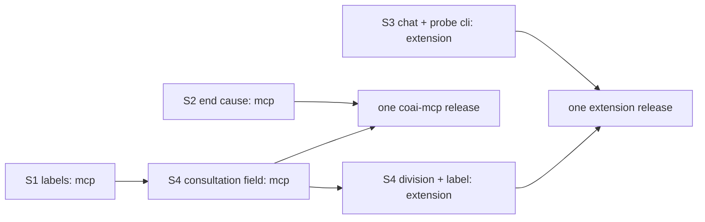

# PLAN — Round counter tail, epic E3: the ledger's metadata and its presentation

> Status: **plan only, nothing implemented yet (2026-10-20).** Stories of epic E3 of [PLAN_the_round_counter_tail.md](PLAN_the_round_counter_tail.md).
>
> Scope: four stories. S1 labels on consult, check, question and probe lines; S2 a local `endCause` taken from the
> cancellation's SOURCE; S3 `cli` and `cliVersion` on the lines the EXTENSION writes (chat, and its Claude model probe);
> S4 per-consultation money with a new `consultation` field. **No cornerstone** (the parent names none for E3; §3 says why
> the code does not change that). Nothing here waits for M1.
>
> Related: [module_runners.md](../research/module_runners.md) (the ledger line, `EndCauses`), [module_server.md](../research/module_server.md)
> (the consultation, the check, the question row, the probe, the round engine), [module_extension.md](../research/module_extension.md)
> (the chat ledger, `roundMoney.ts`, the Rounds block), [module_tests.md](../research/module_tests.md) (each RED message and its plant).

## 1. What E3 delivers

After E3, every local ledger line that story 3.4 of the promoted plan left blank says what its launch ran with; a local
review line that ends `Cancelled` says which token killed it; a chat line and an extension probe line name their CLI and its
version where one was already asked; and the Rounds block divides consultation money by CONSULTATIONS. Every new field is
trailing, defaulted and absent on older lines — an older reader ignores it (`parseUsageLine` builds known fields only,
`src_vs_code/src/usage.ts:143-176`; `parseChatUsageLine` likewise, `chatUsage.ts:263-293`).

## 2. Where the code differs from the parent plan (verified 2026-10-20 in this worktree)

1. **The consultation id is `record.Id`, not "`consultationId`, `ConsultationService.cs:118`".** Line 118 is a doc comment. The
   id a consultation carries is minted by `ConsultationStore.NewId()` (`ConsultationService.cs:627`); the answered turn has
   `record.Id` at `Settle` (`:833-848`), a failed turn has `failed.Next.Id` (`ConsultationFailedTurns.cs:167-174`).
2. **There are TWO more consult-line writers than the parent names.** Besides `ConsultationService.cs:848` the failure path
   bills through `ConsultationFailedTurns.Billed` (`ConsultationFailedTurns.cs:132-133`, called at `:170`), and the consultant
   check through `ConsultantCheck.Billed` (`ConsultantCheck.cs:358-359`, called at `:318`, `:334`). All three end in
   `ConsultantTurnBooks.Billed` (`ConsultantTurnBooks.cs:50-52`) — the one place S1 and S4 change.
3. **Three consultant adapters build their own invocation and set no `Sent`.** `CodexConsultant.Build`
   (`src_mcp/runners/Consultation/CodexConsultant.cs:68-88`) puts `inner.TierArgs(launch.Settings)` on the argv and leaves
   `Sent` at `SentOptions.Nothing` (`ReviewerRuntime.cs:268`); the codex REVIEWER sets it (`ReviewerRuntime.cs:679-682`).
   `ClaudeConsultant` and `AntigravityConsultant` send no effort and no tier, so `Nothing` is true for them. Api and Local
   consultants delegate to the reviewer adapter's `Build`, which sets `Sent`. Without the codex fix, S1 would label a codex
   consultation's tier as *not sent*.
4. **No surface shows `endCause`, effort, tier or `cliVersion` today.** The extension parses `endCause` (`usage.ts:67-72`,
   `:289-290`) and shows it nowhere; `roundsBlock.ts` has no effort/tier/version cell. So S2 has **no help text to change**
   (the parent's "the extension (the help)" has nothing to attach to) and S3's "the Rounds block says *not recorded*" has no
   cell to say it in. Decided: S2 changes the comment at `usage.ts:67-72` only; S3 changes no view. Only S4 changes a label a
   person reads.
5. **No host stopping token reaches the round engine.** `ServeAsync` holds `stopping` (`src_mcp/src/Program.cs:2098`) and a
   linked `startStop` handed to `StartedAsync` as `stop` (`:2133-2135`, `:2272-2278`); `PanelServiceHost` is built without it
   (`:2299-2300`) and `PanelService` builds `RoundEngine` (`PanelService.cs:135-137`) with no token. S2 therefore plumbs one.
6. **The local outcome of a cancelled line is a sentence, not `Cancelled`.** `LaunchLines.OutcomeOf` writes
   `ReviewerSummaryFactory.DescribeWhole(outcome)` (`LaunchParts.cs:69-70`), so the server's rule "the line whose outcome is
   `Cancelled`" (`src_server/src/Jobs/JobRunner.cs:370-372`) cannot be copied as text. S2 places the cause the way `ResetsUtc`
   is placed: on the turn's LAST line, when the turn's outcome `is ReviewerOutcome.Cancelled` (`UsageLedger.cs:397-407`).
7. **The extension writes probe lines too.** `probeUsageFile.ts` appends kind `probe` lines to `probe-usage.jsonl`
   (module_extension.md, the `probeUsageFile.ts` row) with no `cli`. The parent's DoD says "probe lines say what they ran
   with"; S3 covers this second writer (the CLI is `claude`; `claudeProbe.ts:58` already asks its version).
8. Small line shifts: `RoundEngine.cs:287-288` (not 288-289) for `clock` and `roundClock`; `unitDivisor` is
   `roundMoney.ts:298-300`; `ChatTurnRecord` is `chatUsage.ts:38-71`. The per-kind figure is drawn by `kindLine`
   (`roundsBlock.ts:377-390`), which hard-codes *per recorded turn* at `:387`.

## 3. Decisions the parent left open (decided here)

- **D1 — the labeller is reused, widened by one nullable parameter.** `RowLaunchOptions.Of`'s `runtime` becomes
  `IReviewerRuntime?` (`RowLaunchOptions.cs:28-42`; it is read only by `runtime is CodexRuntime` at `:41`), and a sibling
  `RowLaunchOptions.Answering(built, row, launch)` labels a consultant invocation from `built.Adapter` (the inner reviewer
  adapter every consultant carries, `ReviewerRuntime.cs:214-223`). *Reason:* one labeller for review and answering launches;
  `IConsultantRuntime` is not an `IReviewerRuntime`, its `Adapter` is.
- **D2 — the version on a consult/question/check line is the codex tier probe's `Printed`, else the final launch's
  `CliVersion` (Vibe's launch control), else empty.** The reviewer's rule, `UsageLedger.VersionedBy` (`UsageLedger.cs:385-388`),
  moves to `LaunchOptions.VersionedBy(string asked)` and both paths call it. *Reason:* one rule, and both sources are versions
  already asked — no spawn.
- **D3 — the probe's effort is labelled `row`.** `--probe-api` sends `variant.Effort` (`ProbeApiMode.cs:208-209`, `:246`);
  `OptionSources.Row` already means "sent, from what coai fills in" (`LaunchOptions.cs:18-21`). `cli: api`, no version, no tier.
  *Reason:* a sixth source word would have to be learned by every reader for one kind that is never compared across rows.
- **D4 — the host token goes to `PanelServiceHost` as a REQUIRED parameter and to `PanelService` as a trailing
  `CancellationToken hostStopping = default`** (the `environment = null` precedent, `PanelService.cs:57`). *Reason:* the
  production road (`Program.cs:2299`, 7 host sites) cannot forget it; 33 service-level test sites never stop a host, and a
  `PanelServiceHostTests` case pins that the host hands its token to every service it builds.
- **D5 — precedence `hostStopped` > `withdrawn` > `roundClock` > `unknown`.** A host stop may cancel in-flight requests, so it
  must not be filed as a person's withdrawal; a person who cancels as the clock fires is a person — the rule `WhatEndedIt`
  already states (`RoundEngine.cs:841-842`). `unknown` is a `Cancelled` turn when none of the three fired (a Team-server row
  whose server ended it, any token linked elsewhere). Never read from a sentence.
- **D6 — `roundClock` and `unknown` are LOCAL words.** `EndCauses` gains both and a `LocalOnly` list (the
  `UsageKinds.LocalOnly` shape, `UsageLedger.cs:66`); `Known` (`EndCauses.cs:47`) names all seven. The server writes neither and
  is unchanged; `HowAJobEndedIsSaidTests` pins the server's four words, not `Known`.
- **D7 — the chat line's `cli` is the row's runtime, written; an old line reads empty.** It is the same value as the `vendor`
  the line already carries (`chatTurn.ts:594-607`), but `vendor` says whose ROW the line belongs in and `cli` says what RAN —
  the usage ledger keeps `provider` and `cli` apart for the same reason. The reader never derives `cli` from `vendor`.
- **D8 — a consultant check line carries no `consultation`** and is its own unit in the division; a consultation refused before
  its launch whose record was never written (`ConsultationFailedTurns.cs:102`, id emptied) carries none either. *Reason:* there is
  no consultation behind either; an invented id would merge unrelated turns.
- **D9 — the label is *per consultation* when every consult line of the group carries an id, and *per consultation (older
  lines per turn)* when any does not;** the tooltip says how many lines were counted one each and why (older lines, checks).
  *Reason:* a qualifier that is false for the window misleads.
- **Cornerstone: none, confirmed.** Every change is an additive trailing field or one new word on an append-only file; a wrong
  value costs one release's lines, which the reader still prices (no `usageNote`, no money change). The one money change (S4) is
  a divisor, never a total.

## 4. Order and parallel work

- **S1 before S4's C# half:** both change the local `RecordJob` overload and `ConsultantTurnBooks.Billed`; S4 adds one
  parameter to what S1 reshapes. One coder, in that order.
- **In parallel:** S2 (`EndCauses.cs`, `RoundEngine.cs`, `PanelService*.cs`, `Program.cs`, `UsageLedger.Record`/`AppendTurn`)
  beside S1; S3 (`chatUsage.ts`, `chatTurn.ts`, `probeUsageFile.ts`) beside both. **Shared files to merge with care:**
  `UsageLedger.cs` (S1 the `RecordJob` overloads `:510-534`; S2 `Record`/`AppendTurn` `:356-407`) and `roundMoney.ts` (S3
  `chatLedgerLines` `:335-348`; S4 `LedgerLine` `:39-40` and the divisor). S4's extension half can be coded against the field
  name before the mcp half merges.
- The epic ships as one branch, one pull request, the coai gate once (plan round with E3 declared, code round over the diff).

## 5. Stories

### E3.S1 — consult, check, question and probe lines say what they ran with

**Test scenarios (RED first; `src_mcp/tests/TheAskingLinesSayWhatTheyRanWithTests.cs`, fixtures: the `UsageLedger` over a temp
data dir as `TheConsultLedgerKeepsEveryUsageFieldTests.cs:20-60` builds it, a fake launcher as `EachLineSaysWhatItRanWithTests.cs:295`):**

| Test | Asserts | RED today because |
|---|---|---|
| `AConsultationLine_SaysWhatItRanWith` | a codex consultation turn (fake launcher answering the tier probe with `codex-cli 0.131.0`): the line has `cli: codex`, `cliVersion: codex-cli 0.131.0`, `tier`/`tierFrom` as sent, `effort` from `cli-config` when the fake `config.toml` names one | `ConsultantTurnBooks.Billed` calls the overload that writes `JobPlace(LaunchOptions.None)` (`UsageLedger.cs:510-513`): every field empty |
| `AFailedConsultationLine_SaysWhatItRanWith` | the same on the failure path (`ConsultationFailedTurns.Billed`) | same overload |
| `AConsultantCheckLine_SaysWhatItRanWith` | a check line (role `consult-check`) carries `cli` and the labels | `ConsultantCheck.cs:358-359`, same overload |
| `AQuestionRowLine_SaysWhatItRanWith` | a codex question row (`TierProbedAsync`, `QuestionRowLaunch.cs:205-208`): `cli`, `cliVersion`, `tier` | `QuestionRowLaunch.cs:455-458`, same overload |
| `AProbeLine_SaysWhatItRanWith` | in `ProbeApiModeTests.cs` over `ApiEndpointStub`: each paid line has `cli: api`, `effort` = the variant's, `effortFrom: row`; the plain variant has no effort | `ProbeApiMode.cs:285-287`, same overload |
| `ACodexConsultantsLaunch_SaysTheTierItSent` | `CodexConsultant.Build` for an Off row on a release that takes it: `Sent.Tier == "default"` | `Sent` is never set there (§2 item 3) |
| `ALineWhoseCliWasNeverAsked_HasAnEmptyVersion_AndSpawnsNothing` | a claude consultation: `cliVersion` empty, and the fake launcher saw no `--version` request beyond what it saw before | — (guard: green before and after; a plant that asks `--version` per launch goes red) |
| `AnOldLine_ReadsEveryLabelEmpty` (extension, `usagePricing.test.ts`) | a consult line with none of the fields parses with `cli`, `effort`, `tier` absent | — (guard) |

**The brief.**
1. `RowLaunchOptions.cs:28` — `runtime` becomes `IReviewerRuntime?`; add `Answering(ReviewerInvocation built, ProviderSettings row,
   ReviewerSettings launch) => built with { RanWith = Of(built.Sent, row, built.Adapter, launch, Environment.GetEnvironmentVariable) }`
   beside `Labelled` (`:23-25`). Its summary names this plan.
2. `CodexConsultant.cs:86-88` — `new ReviewerInvocation(…) { Sent = new(Tier: SentOptions.TierIn(inner.TierArgs(launch.Settings))) }`,
   the reviewer's line `ReviewerRuntime.cs:679-682` reused. No other adapter changes (§2 item 3).
3. `LaunchOptions.cs` — `public LaunchOptions VersionedBy(string asked) => CliVersion.Length == 0 && asked.Length > 0 ? this with
   { CliVersion = asked } : this;` and `UsageLedger.VersionedBy` (`:385-388`) calls it (byte-identical for reviews).
4. `UsageLedger.cs:510-513` — the local overload takes `LaunchOptions ranWith` as a REQUIRED parameter after `stage` and hands
   `new JobPlace(ranWith)`; `resetsUtc` stays defaulted after it. The `<see cref>` at `:415` is updated. The Team-server overload
   (`:524-529`) is the shape copied and is not touched.
5. `ConsultantTurnBooks.Billed` (`ConsultantTurnBooks.cs:50-52`) takes `LaunchOptions ranWith` and passes it.
6. Consultation: `ConsultationService.cs:681` labels — `RowLaunchOptions.Answering(consultant.Runtime.Build(ready.Launch),
   consultant.Row, ready.Launch.Settings) with { Redact = … }` (`ready.Launch.Settings` holds the tier probe's `CodexTier`);
   `TurnConsultant` (`ConsultationFailedTurns.cs:17`) gains `LaunchOptions RanWith { get; init; } = LaunchOptions.None`, set in
   the `with` at `ConsultationService.cs:683`; `Settle` (`:848`) and `ConsultationFailedTurns.Billed` (`:132-133`) pass
   `consultant.RanWith.VersionedBy(final launch's CliVersion)`. `ConsultationService.cs` is 1 005 lines under an open size plan
   (`PLAN_consultation_service_and_program_under_800_lines.md`): net growth ≤ 2 lines, nothing extracted here.
7. Check: `ConsultantCheck.cs:249` labels the same way with `ready.Launch.Settings`; the private `Turn` record (`:195-197`) gains
   `RanWith`, set at `:252`; `Billed` (`:358-359`) passes it. A check refused before its launch (`:242-246`) bills `LaunchOptions.None`.
8. Question row: `QuestionRowLaunch.cs:325` labels with `input.Row.Provider` and `launch.Settings`; `Record` (`:455-458`) takes the
   invocation's `RanWith.VersionedBy(landed[^1].CliVersion)`. A ready continuation (`ready`) keeps the first's labels (`first with { … }`).
9. Probe: `ProbeApiMode.Spent` (`:263-269`) hands the variant on; `Written` (`:285-287`) passes
   `LaunchOptions.Of("api", "", new OptionChoice(variant.Effort, OptionSources.Row), new OptionChoice("", ""), CliDefaults.None)`.

**Not changed:** the Team-server overload and `JobRunner`; the round's reviewer labelling (`RosterBuilder.cs:472-476`,
`SecurityRoster.cs:157`); `Round`, `Turn`, `Attempt` stay empty on these kinds (`ALocalReviewLineCarriesItsRoundTests.cs:116`
still green). **Ships:** coai-mcp. **Docs:** `module_runners.md` (the ledger line: which kinds carry the 3.4 fields now; the
`VersionedBy` rule), `module_server.md` (consultation, check, question row, probe — what their line carries). No help text: no
view shows these fields (§2 item 4).

### E3.S2 — a local end cause, from the cancellation's source

**Test scenarios (RED first; `src_mcp/tests/ALocalCancellationCarriesItsSourceTests.cs`):**

| Test | Fixture → asserts | RED today because |
|---|---|---|
| `TheCause_IsReadFromWhichTokenFired` (`[Theory]`, pure) | `EndCauses.OfLocal(host, caller, clock)` over the 8 combinations: host → `hostStopped`; caller → `withdrawn`; clock only → `roundClock`; none → `unknown` | the function does not exist |
| `ALocalCancellation_CarriesItsSource` | a round through `PanelService` with a fake reviewer that blocks until its token fires (the `ARoundIsMintedAKeyTests.cs` shape): (a) the round budget set short → the `Cancelled` line says `roundClock`; (b) the call's token cancelled → `withdrawn`; (c) the service's `hostStopping` cancelled → `hostStopped` | `UsageLedger.Record` takes no cause and `Entry` never sets `EndCause` (`UsageLedger.cs:423-445`): empty on all three |
| `ACancellationNobodyCanName_IsUnknown_NeverEmpty` | a fake reviewer that returns `ReviewerOutcome.Cancelled` with no token fired (a remote row's server ended it) → `unknown` | empty |
| `OnlyTheTurnsLastLine_CarriesTheCause` | a repair then a cancelled second launch: first line no `endCause`, last line the cause; an `ok`, `TimedOut` or `RateLimited` turn → no `endCause` anywhere | — (guard on the placement; a plant that writes it on every line goes red) |
| `TheHost_HandsItsStopToEveryServiceItBuilds` (`PanelServiceHostTests.cs`) | a host built with a token: the first service and a rebuilt one (settings change) expose the same `HostStopping` | the host takes no token |
| `usagePricing.test.ts`: `ALocalCauseWord_IsReadLikeAnyOther` | a line with `endCause: roundClock` and one with `unknown` parse whole | — (guard: `endCauseOf` takes any text, `usage.ts:289-290`) |

**The brief.**
1. `EndCauses.cs` — add `RoundClock = "roundClock"` ("the local round's own deadline ended it") and `Unknown = "unknown"` ("a
   cancellation whose token nobody above the executor can name"); `Known` (`:47`) lists seven; `LocalOnly = [RoundClock, Unknown]`;
   `public static string OfLocal(bool hostStopped, bool callerCancelled, bool clockFired)` — a switch expression in D5's order,
   complexity ≤ 4. The class remarks (`:14-18`) stop saying "a local line's `endCause` is empty".
2. `UsageLedger.Record` (`:356`) gains `string endCause = ""`; `AppendTurn` (`:397-407`) writes it on the LAST line exactly as
   `ResetsUtc` (`at == lines.Count - 1`), and only when the turn's outcome `is ReviewerOutcome.Cancelled` (the caller passes `""`
   otherwise). The `EndCause` doc (`:216-227`) gets the local half.
3. `RoundEngine.cs:422-427` — when `finished is ReviewerOutcome.Cancelled`, pass `EndCauses.OfLocal(_hostStopping.IsCancellationRequested,
   ct.IsCancellationRequested, clock.Token.IsCancellationRequested)`. `RoundEngine` gains a `CancellationToken hostStopping`
   constructor parameter (its one construction, `PanelService.cs:135-137`).
4. `PanelService` (`:50-57`) — trailing `CancellationToken hostStopping = default` (D4), handed to `RoundEngine`; an internal
   `HostStopping` getter for the host test. `PanelServiceHost` takes it REQUIRED and passes it to every `new PanelService`
   (`PanelServiceHost.cs:112`); `Program.StartedAsync` passes `stop` (`Program.cs:2299`). The 6 test hosts pass `CancellationToken.None`.
5. `src_vs_code/src/usage.ts:67-72` — the comment names the two local words and says a local line carries a cause since this
   release. No behaviour change.

**Not changed:** `ProcessLauncher.ResultOf` (`ProcessLauncher.cs:570`) and `ReviewerExecutor.KilledAsync` (`:980-988`) — the
cause is decided above the executor, where the tokens are held, never inferred below it; the server (`UsageReader.cs:58-61`,
`ServerJsonContext.cs:235`, `JobRunner.cs:370-372`) — it never writes a local word; consultation and question-row endings (a
withdrawn consultation writes no line today, a cut question row is `Interrupted`, `QuestionRowLaunch.cs:343`). **Ships:**
coai-mcp (the extension comment rides S4's extension release). **Docs:** `module_runners.md` (`EndCauses`, `:579` paragraph),
`module_server.md` (the engine's end cause, the host token's road). No help: nothing shows the column (§2 item 4).

### E3.S3 — the extension's own lines name their CLI and its version

**Test scenarios (RED first; `src_vs_code/src/test/chatUsage.test.ts`, `probeUsageFile.test.ts`, `roundMoney.test.ts`):**

| Test | Asserts | RED today because |
|---|---|---|
| `AChatLine_SaysWhichCliRanIt_AndItsVersion` | `chatTurnRecord({…, cli: 'codex', cliVersion: 'codex-cli 0.131.0'})` → both on the line; `parseChatUsageLine` reads them back | `ChatTurnRecord` has no such fields (`chatUsage.ts:38-71`); `chatTurnRecord` (`:223-242`) and the parser (`:263-293`) build known fields only |
| `AnOldChatLine_ReadsNoCliAndNoVersion` | a line with `vendor` but no `cli` → `cli` absent (D7: never derived from `vendor`) | — (guard; a plant that copies `vendor` into `cli` goes red) |
| `AChatTurnWhoseCliWasNeverProbed_WritesAnEmptyVersion_AndSpawnsNothing` | `ledger(thread, turn)` (`chatTurn.ts:568-608`) with a version port that has nothing cached → `cliVersion` absent, and a counting probe port shows 0 calls | the record has no field |
| `ChatLedgerLines_CarryTheCli` | `chatLedgerLines` (`roundMoney.ts:335-348`) maps `cli`; a chat line is still not a launch line (`isLaunchLine` false: no `attempt`) | the mapped line has no `cli` |
| `AProbeLine_NamesClaudeAndTheVersionItAsked` | `probeUsageFile.ts` lines carry `cli: claude` and the `cliVersion` `claudeProbe.ts:58` read | no `cli` on the line |

**The brief.**
1. `chatUsage.ts` — `ChatTurnRecord` gains optional `cli?` and `cliVersion?` (absent = not recorded, the `vendor?` precedent at
   `:61-70`); `FinishedTurn` gains both; `chatTurnRecord` writes each only when non-empty; `parseChatUsageLine` reads each with
   the `vendor` pattern (`:292`).
2. `chatTurn.ts:594-607` — `cli: turn.vendor.runtime`; `cliVersion` from a read-only port on the panel's cache
   (`PanelViewProvider.cliStatus`, `panelProvider.ts:475`, filled by `oneCliStatus` `:1837-1845`) — a `cachedCliVersion(vendorId)`
   getter, `''` when never read. **Never a spawn on the turn's road.**
3. `roundMoney.ts:335-348` — `chatLedgerLines` carries `cli` (D7: never `vendor`).
4. `probeUsageFile.ts` — the line gains `cli: 'claude'` and the version `claudeProbe.ts:58` already holds (`spentOf`, `:59-61`,
   is beside it).
5. Effort and tier stay absent on chat and extension-probe lines; nothing displays them, so no *not recorded* text is added (§2
   item 4).

**Not changed:** `vendor` on chat lines; the chat money and the Rounds block; `isLaunchLine`. **Ships:** extension. **Docs:**
`module_extension.md` (the `chat-usage.jsonl` record, the `probeUsageFile.ts` row). No help: no user-visible label.

### E3.S4 — per-consultation money, per consultation

**Test scenarios (RED first):**

| Test (file) | Asserts | RED today because |
|---|---|---|
| `AConsultLine_CarriesItsConsultation` (`src_mcp/tests/TheConsultLedgerKeepsEveryUsageFieldTests.cs`) | an answered turn's line has `consultation` = the record's id; a second turn of the same consultation the same id; a failed turn's line `failed.Next.Id` | the field does not exist |
| `ACheckLineAndARefusedNewConsultation_CarryNone` (same file) | a check line and a refused-before-launch NEW consultation (`ConsultationFailedTurns.cs:102`) → no `consultation` (D8) | — (guard) |
| `usagePricing.test.ts`: `ConsultationIsRead_AndAnOldLineHasNone` | `parseUsageLine` keeps `consultation`; an old consult line has none | `parseUsageLine` drops unknown fields |
| `roundMoney.test.ts`: `PerConsultationMoney_DividesByDistinctConsultations_AndAnOldLineIsItsOwnUnit` | 3 lines of `A`, 1 of `B`, 2 with no id → the divisor is 4 consultations, `per: consultation` | `kindLine` passes `undefined` (`roundsBlock.ts:383`): 6 recorded turns |
| `roundMoney.test.ts`: `AWindowOfIdentifiedLines_SaysPerConsultation_AndAMixedOne_SaysOlderLinesPerTurn` | label text per D9; the tooltip names how many lines were counted one each | label is *per recorded turn* (`roundsBlock.ts:387`) |
| `roundsBlock.test.ts`: `TheConsultLine_SaysPerConsultation` | the drawn block's consult line shows the per-consultation figure and label; the question and chat lines still say *per recorded turn* | hard-coded at `:387` |
| `helpCoverage.test.ts`: `every language says consultation money is per consultation` | each of the five `what-each-ai-has-used` bodies contains `per consultation` (the shape of `:204-218`) | no language says it |

**The brief.**
1. coai-mcp: `UsageEntry` gains `string Consultation = ""` as its last parameter, after `GaugeWindows` (`UsageLedger.cs:287`; trailing and defaulted like the rest,
   doc: "the consultation this consult line's turn belongs to — empty on a check, an older line and every other kind").
   The local `RecordJob` overload (S1's shape) gains `string consultation = ""`, applied `with { Consultation = consultation }`
   beside `ResetsUtc`; `ConsultantTurnBooks.Billed` passes it; `Settle` (`ConsultationService.cs:848`) passes `record.Id`;
   `ConsultationFailedTurns.Applied` (`:167-174`) passes `failed.Next.Id`; the check passes `""`.
2. extension: `usage.ts` — `UsageEntry` gains `consultation?`, parsed with the `saidText` pattern (`endCauseOf`, `:289-290`);
   `roundMoney.ts` — `LedgerLine` (`:39-40`) adds `'consultation'`; a pure `consultationUnits(lines)` = distinct non-empty ids +
   lines without one; `unitDivisor` (`:298-300`) is reused with that count for kind `consult` (its `UNIT_OF.consult` already
   says `consultation`, `:184`).
3. `roundsBlock.ts` — `kindLine` (`:377-390`) takes the divisor from `consultationUnits` for `consult` and the label per D9;
   `question` and `chat` keep *per recorded turn*. The FOOTNOTE (`:121-126`) says consultations are per consultation. The card's
   *consult turns* (`:395-418`) still counts turns and says so — unchanged.
4. Help in five languages: one sentence after the consultations clause of `helpContent.ts:465` and its twins
   (`helpDe.ts:208`, `helpEs.ts:208`, `helpRu.ts:208`, `helpUk.ts:200`) — consultation money is divided per consultation; a line
   written before this coai-mcp release and a consultant check count one each, and the label then says *per consultation (older
   lines per turn)*. The label words stay English in every language, as every control name there is.

**Not changed:** the consult LINE count or its money (census rows 2 and 4 stay one line per turn — the parent's non-item); the
question row; the Team server. **Ships:** coai-mcp (the field) and extension (division, label, help). **Docs:**
`module_runners.md` (the field), `module_server.md` (which writer fills it), `module_extension.md` (`roundMoney.ts`,
`roundsBlock.ts` rows and the Rounds block paragraph).

## 6. Risk

- **A wrong labeller changes a review line.** `RowLaunchOptions.Of`'s widening and `VersionedBy`'s move are byte-identical for
  reviews: `EachLineSaysWhatItRanWithTests` and `ALocalReviewLineCarriesItsRoundTests` stay green unchanged.
- **The host token on the wrong road.** Required on `PanelServiceHost`, pinned by its test; a `default` on `PanelService` only
  ever means "this host never stops", which is true of every test that builds one directly.
- **A cause filed wrong.** D5's order is the existing `WhatEndedIt` rule plus the host; `unknown` keeps every unexplained
  cancellation visible rather than guessed.
- **A divisor of zero.** `perUnit` already draws a dash for 0 units (`roundMoney.ts:312-316`).

## 7. Definition of Done

- [ ] Each story's tests written first and seen RED with the symptom in §5 (the message recorded), then GREEN; each guard test
      proven by its plant (reverted fix → RED, restored → GREEN); messages and plants in `research/module_tests.md`.
- [ ] `src_mcp` test project green in full (`CoaiMcp.Tests` executable; `src_server` tests too, since `EndCauses` lives in the
      shared library); the extension's `npm test` green in full, `helpCoverage.test.ts` included.
- [ ] Parent test rows 9–12 green from red (named here as S1–S4's tests; row 12's division lives in `roundMoney.test.ts`).
- [ ] `module_runners.md`, `module_server.md`, `module_extension.md` updated; `module_team_server.md` needs nothing (the server is
      unchanged) and the summary says so; help in five languages for S4's label only.
- [ ] One coai-mcp release (S1, S2, S4's field) and one extension release (S2's comment, S3, S4) noted in the parent's build-order
      row; the parent's E3 boxes ticked; `node .agents/conventions/tools/plan-lifecycle.mjs` clean.
