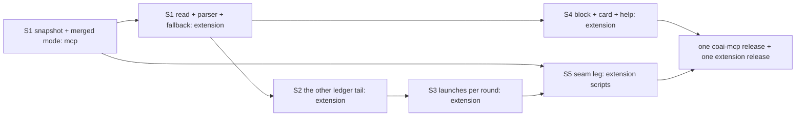

# PLAN — Round counter tail, epic E6: both stores are counted, and launches per round

> Status: **plan only, 2026-10-21 — the stories of epic E6, and the S1 cornerstone spec, by Fable.** Stories of epic E6 of
> [PLAN_the_round_counter_tail.md](PLAN_the_round_counter_tail.md) (its "### E6"), written the way
> [the E3 stories](PLAN_the_round_counter_tail_E3.md) were.
>
> Scope: five stories. S1 (**CORNERSTONE**) a 7-day snapshot of the rounds database written by the owning side after every
> round, and a NEW one-shot mode `--round-counts-merged` that counts this side's `coai.db` and every snapshot it is handed as
> ONE population keyed by `round_key`; S2 the other side's ledger tail beside this side's; S3 launches per round over the rounds
> whose lines carry a key; S4 the Rounds block and the Models card over two stores; S5 the live contract leg. Depends on E3
> (columns only: `endCause`, `cliVersion` are read as fields, never interpreted here).
>
> Related: [module_server.md](../research/module_server.md) (`--round-counts`, the round engine's projection write),
> [module_extension.md](../research/module_extension.md) (`roundCounts.ts`, `roundsBlock.ts`, the Rounds block),
> [module_runners.md](../research/module_runners.md) (`AtomicFile`), [module_tests.md](../research/module_tests.md) (each RED
> message and its plant), [PLAN_every_round_is_counted.md](../research/PLAN_every_round_is_counted.md) (the promoted plan
> whose *Open tail* this closes: "the counter reads one store", "launches per round").

## 1. What E6 delivers

After E6, a Windows window whose owner also runs rounds inside WSL sees ONE Rounds block over both stores: each vendor row's
5 h / 24 h / 7 d counts are the distinct rounds of BOTH stores, each store is named with its own part and its freshness
(*WSL: Ubuntu, as of 3 min ago*), a store that could not be read is *not included* with the reason — never a 0 — and a store
that has been quiet for a week is 0 *as of* its last write. The same block says *launches per round* for the rounds whose
ledger lines carry their key. The other side's `coai.db` is never opened across the `\\wsl.localhost` / drvfs boundary (it is
WAL; its locks are not coordinated across that boundary — `roundCountsRead.ts:19-21`): what crosses is a plain JSON file the
owning side writes after every round, and that side's append-only `usage.jsonl`, read from its end as this side's is.

An older `coai-mcp` on this side answers the new mode with 64 and the extension shows today's single-store sentence; an older
extension reading a new binary's `--round-counts` ignores the two trailing fields the answer gains. An older `coai-mcp` on the
OTHER side writes no snapshot and that store is *not included: no snapshot* — with the cure named (update coai-mcp there).

## 2. Where the code differs from the parent plan (verified 2026-10-21 in this worktree, `b5ff2f3bd`)

1. **The projection write is `RoundEngine.cs:621-653`, not `:620`, and `RecordRound` is `RoundsDb.cs:196-210`, not `:190`.**
   The lambda handed to `Projection.Write` calls `db.RecordRound(...)` at `:623-638` and then, in the SAME lambda,
   `db.DecidedEarlier` / `db.RecordConsultMissed` (`:646-648`). `Projection.Write` (`Projection.cs:24-38`) swallows every
   exception and logs *"{What} could not be projected into the rounds database"*. So the snapshot must NOT be written inside
   that lambda: a failed file write there would (a) be logged as the ROUND failing to project, which is false, and (b) skip
   the stuck-findings count after it. **Decided (D2):** the snapshot is written after `_projection.Write` returns, by its own
   method with its own `try`/`catch` and its own log sentence.
2. **`AtomicFile.Write` is `AtomicFile.cs:46-63`** (the class at `:31`; the parent's `:25` is a remarks line). It needs the
   destination directory to exist (`:40`) — true after `RoundsDb.Open` (`RoundsDb.cs:66`) — and retries a move over a held file
   for `sharingRetry` (`:37`, 500 ms). The remarks at `:27-28` list its callers; E6 adds one.
3. **`RoundCounts.Launch` (`RoundCounts.cs:83`) carries no key, and `Distinct` (`:198`) counts `RoundId`** — the collapse the
   parent names. `Read` is `:113-129` (parent `:113-125`); `SqlLaunches` `:153-157` and `Cut` `:159-168` as the parent says.
   `round_key` must be SELECTED behind `RoundsQuery.HasColumn` (`RoundsQuery.cs:917`), exactly as `model` is (`:122`, `:137`):
   a reader never migrates (`Schema.cs:611-612`), so a `--round-counts` on a step-20 file must not ask for the column.
4. **A store id rule already exists.** `RoundAuthorsMerge.SourceIdOf` (`RoundAuthorsMerge.cs:81-86`): lower-case hex of the first
   16 bytes of the SHA-256 of the canonical path (`GetFullPath`, no trailing separator, upper-cased where the file system folds
   case) — and `PlatformFamily` (`:88-89`, private). Reuse-first: the snapshot's `store.id` IS `SourceIdOf(dataDir)`, computed
   by the OWNER from its own spelling. The WSL distro is read as `ConsultantsReadMode.cs:62` reads it (`WSL_DISTRO_NAME` when
   `HostKind.Current` is `Wsl`, `HostKind.cs:30`).
5. **The directories do not come from `configTransfer.ts:34`.** That line only says the setting is never exported. The list is
   read by `alsoWatchDataDirectories()` (`escalationWatcher.ts:29-33`), filtered by `watchedDirs`/`usableDirs`
   (`escalationDirs.ts:84-115` — an entry spelled for the other OS is KEPT but has no path, `:106-110`), and the panel hands
   `usableDirs(...).slice(1)` to `otherStores` at `panelProvider.ts:692` and `:702`. `dirKey` (`:67-72`) folds case and slashes
   but NOT the two UNC hosts: `\\wsl$\Ubuntu\…` and `\\wsl.localhost\Ubuntu\…` are two entries. The store id (item 4) is what
   makes them one store. The side label is `sideLabel(vscode.env.remoteName, WSL_DISTRO_NAME)` (`coaiInstall.ts:394-405`).
6. **No new setting and no discovery.** From a Windows window a WSL store is found only when the person named it
   `\\wsl.localhost\<distro>\home\<user>\.local\share\coai-mcp` (`escalationDirs.ts:47-49`: *no distribution is guessed*); from
   WSL a Windows store only as `/mnt/c/…`. E6 keeps that rule (item 6 of the open questions says why it is not widened here).
7. **`storeSentence` is `roundsBlock.ts:112-117`** (parent `:110-115`); `StoreFacts` `:43-48`; `cardRoundsLine` `:415-424`;
   `FOOTNOTE` `:123-130`. `isLaunchLine` is `roundMoney.ts:71-73` (parent `:69-71`); `ONE_LAUNCH_ATTEMPTS` `:57`;
   `NOT_ONE_LAUNCH_ATTEMPTS` `:60-63`. E2.S4 (not on this branch) will make `isLaunchLine` read `usageBasis`; S3 calls it and
   inherits whichever rule is on main when E6 rebases.
8. **The spawn cap is 8 s** (`roundCountsRead.ts:25`) and `serverRun` (`roundsDbRead.ts:329-331`) adds `serverEnv()` so the
   child resolves THIS side's directory. A snapshot read over a dead `\\wsl.localhost` share can stall inside that cap — the
   whole merged answer would then be *did not answer in time*. **Decided (D7):** a merged timeout falls back to `--round-counts`.
9. **`.agents/PROJECT.md:53-55`** is the one-shot list and `:59-76` the 64 rule, as the parent says. The `--findings-many`
   precedent: its own `args[0]` (`Program.cs:364`), 65 for a request fault (`:1568`, `:1577-1600`), 74 for the database
   (`:1619`), never 64. The scenario control is `RoundCountsCliScenarioTests.ABadArgument_IsAUsageErrorNot64` (`--round-countz`
   → 64).
10. **`shared/data-inventory.json` must learn the new file.** `TheRunsAreAccountedForTests` (`src_mcp/tests/…:467`) and the
    extension's `theInventoryIsComplete.test.ts` scan both halves' sources for paths composed under the data directory; a
    file the inventory has never heard of is a red test. The snapshot is *move: false, mention: false* — "written again by
    itself" (the inventory's own third fate, `shared/data-inventory.json:21`).
11. **`.agents/conventions` is not checked out in this worktree**, so `plan-lifecycle.mjs` (CI runs it, `.github/workflows/ci.yml:191`)
    could not be run here; this file's status line follows the E3 document's exact shape.
12. Line shifts: the help sentence about the other store is `helpContent.ts:465` (*…says that store's rounds are not included:
    it is never opened across the boundary*), `helpDe.ts:208`, `helpEs.ts:208`, `helpRu.ts:208`, `helpUk.ts:200`.

## 3. Decisions the parent left open (decided here)

- **D1 — the store id is `RoundAuthorsMerge.SourceIdOf`, computed by the owner, over its HOST as well as its directory.** The
  owner hashes `<platform>|<wslDistro or empty>|<canonical dataDir>` (plan round finding 0: two WSL distributions share the default
  `/home/<user>/.local/share/coai-mcp`, so the directory alone would merge two stores into one). A snapshot carries the id its writer computed
  from ITS OWN host and canonical directory; two UNC spellings that open one file read byte-equal ids and merge to one store, whose
  `paths[]` names both spellings. *Reason:* one id rule in the repository (reuse-first step 1); nothing on the reading side
  has to know that `\\wsl$` and `\\wsl.localhost` are one host.
- **D2 — the write point is after the projection returns, through `RoundCountsSnapshot.TryWrite(dataDir, nowUtc, log)`**, a
  static with its own `catch` and the sentence *the round-counts snapshot could not be written: {why}* (§2 item 1).
- **D3 — the snapshot re-reads the database read-only through the same scan the mode uses.** `RoundCounts.LaunchesIn(dataDir,
  nowUtc)` is extracted from `Read` (`:121-123`) and both call it. *Reason:* the snapshot and `--round-counts` cannot disagree
  about which rounds are "the last 7 days"; the writer holds no connection across the file write.
- **D4 — distinct rounds are keyed by `Launch.Key`**: `round_key` when non-empty, else `<storeId>#<id>`. `Distinct` counts keys.
  For this side alone the numbers are byte-identical to today's (one key per round either way) — `RoundCountsTests` stay green
  unchanged.
- **D5 — zero snapshot paths is a valid merged request** (this side alone, `stores[]` of one). *Reason:* the extension calls the
  merged mode whenever the binary has it, because S3 needs `roundKeys` even with no other store; the plain mode stays the
  fallback for an older binary. At most 32 paths; a 33rd is 65.
- **D6 — the plain `--round-counts` row gains `roundKeys` and `roundsWithoutKey`, trailing.** An older extension builds known
  fields only (`roundCounts.ts:174-183`) and reads the answer unchanged.
- **D7 — the extension's read is: merged first; exit 64 → plain, today's sentence; a merged TIMEOUT → plain, and every snapshot
  store is *not included: did not answer in time*.** Never a number from a call that did not answer.
- **D8 — the other store's ledger tail is summed into the row's tokens and money, with provenance in the block's note**, not a
  second row. *Reason:* the parent's risk row says rows merge by vendor NAME with each store's part shown; a second row per
  store would read as two accounts.
- **D9 — launches per round is drawn once per row, for 7 d, in a cell beside *Reviewers per round*; 5 h and 24 h in its tooltip.**
  The table already has ten columns. The *N rounds carry no launch count* fact is in the same tooltip, with *written before
  coai-mcp 0.60.2* only for the rounds whose key is empty (G8).
- **D10 — a `remote` row's cell is a dash saying *launches run on <server>, not recorded here*.** Its launch lines are `cli:
  remote` and never launches (`isLaunchLine`), so a number would always be 0.
- **D11 — `modelsKnownSince` of the merged answer is THIS side's.** A snapshot round contributes to a model line where its
  reviewer recorded a model, and the field is documented as this side's instant.
- **D12 — one pull request for the epic, stories as ordered commits** (the parent: one PR per epic, the gate once). Considered
  and rejected: an mcp PR then an extension PR — the seam leg (S5) runs the binary built from the SAME tree, so nothing waits
  for a release, and two PRs would be two code rounds over one contract.
- **Cornerstone S1, confirmed.** It is the only story that changes a NUMBER two sides must agree on, and a wrong key rule is
  the one defect no later story can see (a collapsed round reads as a smaller, plausible count).

## 4. The S1 cornerstone spec

### 4.1 The snapshot file — `round-counts-snapshot.json`, beside `coai.db`

Written by the owning side's `coai-mcp` after every round it records. Plain JSON, UTF-8, no BOM, one document; written by
`AtomicFile.Write(path, text, AtomicFile.SharingRetry)` so a reader sees the old file or the new one, never a torn one
(`AtomicFile.cs:9-11`). Serialised by a source-generated context of its own (`RoundCountsSnapshotJson`, the `RoundAuthorsJson`
shape), so Native AOT publishes it.

```json
{
  "schema": 1,
  "writtenUtc": "2026-10-21T09:14:03.1234567Z",
  "coaiMcpVersion": "0.63.0",
  "store": {
    "id": "3f9c2b7e1a4d5c6f8e9a0b1c2d3e4f50",
    "platform": "linux",
    "host": "wsl",
    "wslDistro": "Ubuntu",
    "side": "",
    "directory": "/home/<user>/.local/share/coai-mcp"
  },
  "fromUtc": "2026-10-14T09:14:03.1234567Z",
  "truncated": false,
  "rounds": [
    {
      "id": 42,
      "key": "9b1f6e2d4c8a7b5e3f1d0c9a8b7e6d5c",
      "startedUtc": "2026-10-21T09:02:11.4455667Z",
      "stage": "CodeReview",
      "reviewers": [
        { "provider": "codex", "model": "gpt-6-luna" },
        { "provider": "codex", "model": "gpt-6-luna" },
        { "provider": "gemini", "model": "gemini-3.8-flash-medium" }
      ]
    },
    { "id": 41, "key": "", "startedUtc": "2026-10-20T17:40:00.0000000Z", "stage": "PlanReview",
      "reviewers": [ { "provider": "codex", "model": "" } ] }
  ]
}
```

| Field | Type | Meaning |
|---|---|---|
| `schema` | integer, **1** | The handshake (§4.5). Bumped only on a change a schema-1 reader could misread; an added field keeps 1. |
| `writtenUtc` | `"O"` UTC stamp | The writer's clock at the write — the reader's `asOf`. Never clamped: a WSL clock ahead of Windows after a sleep is shown ahead. |
| `coaiMcpVersion` | string | `Program`'s own version, for the cure sentence of a newer schema. |
| `store.id` | 32 lower-case hex | `RoundAuthorsMerge.SourceIdOf` over `<platform>|<wslDistro>|<dataDir>` (D1). |
| `store.platform` | `windows` / `linux` / `macos` / `other` | `RoundAuthorsMerge.PlatformFamily()` (made internal). |
| `store.host` | `HostKind.Current` as its word (`HostKind.cs:72`: `wsl`, …) | Tells WSL from native Linux. |
| `store.wslDistro` | string | `WSL_DISTRO_NAME` when `host` is `wsl`, else empty. |
| `store.side` | string | `PanelSettings.DataSide(env)` — the partition name, usually empty. |
| `store.directory` | string | The owner's own absolute spelling of the data directory. |
| `fromUtc` | stamp | `writtenUtc − 7 d` (`RoundCounts.Windows[^1]`): the oldest round the file can hold. |
| `truncated` | boolean | `true` when the cap dropped rounds (§4.3). |
| `rounds[]` | array, newest first | Every round with `started_utc` in `(fromUtc, writtenUtc]`, one entry per `rounds` row. |
| `rounds[].id` | integer | `rounds.id` — the AUTOINCREMENT id, meaningful only with the store id. |
| `rounds[].key` | string | `rounds.round_key` (32 hex, `Schema.cs:614-616`); `""` for a round written before step 21 or a skipped round. |
| `rounds[].startedUtc` | stamp | `rounds.started_utc`, verbatim — what the windows are cut on. |
| `rounds[].stage` | string | `rounds.stage`, the enum's own name (`PlanReview` …), exactly as `StagesOf` reads it (`RoundCounts.cs:185-196`). |
| `rounds[].reviewers[]` | array | One per `reviewers` row of the round: `provider` as stored (a Team-server row is `<server>-<vendor>`), `model` or `""`. |

Nothing else: no plan text, no findings, no caller, no session id. The file is a COUNTING record, and it crosses the boundary
in the clear.

### 4.2 The write point and its failure

`RoundEngine` — after `_projection.Write(...)` returns (`RoundEngine.cs:653`) and before the escalation notice (`:654`):
`Store.RoundCountsSnapshot.TryWrite(_settings.DataDir, _time.GetUtcNow().UtcDateTime, _log)` (the engine's clock is whatever
`RoundRecord.CompletedUtc` was stamped from; the test fixes it). `TryWrite`:

1. Opens `coai.db` read-only (`RoundCounts.OpenReadOnly`, `:96-111`) — the same open as the mode, no migration; if the file is
   not there (the projection could not open it) it returns without writing.
2. Reads `RoundCounts.LaunchesIn(dataDir, nowUtc)` (D3; `round_key` behind `HasColumn`), groups by round id, orders newest
   first, applies the cap (§4.3), serialises, `AtomicFile.Write`.
3. **Catches everything** (`Projection.Write`'s rule, `Projection.cs:34-37`: a projection must never take a round down) and
   logs ONE warning: *the round-counts snapshot could not be written: {e.GetType().Name}* — the exception's TYPE only, never its
   message (a filesystem message carries the destination path, and with it the user's name; plan round finding 4). The round's answer is already built; nothing about it changes.

Best effort is the whole contract: a snapshot older than the latest round is a STALE store, visible through `writtenUtc`, and
the next round's write cures it. `--round-counts` and `--round-counts-merged` write nothing — `AReaderModeNeverMakesTheDataDirectoryTests`
gains the merged mode, and `RoundCountsTests` asserts the plain read leaves no snapshot behind.

**Residual, recorded:** five servers on one data directory (`RoundsDb.cs:28-30`) each write the snapshot after their own round.
A writer that read the database and then paused can replace a snapshot written later, so EVERY round committed in between is
missing until the next write (risk consultation 45e39f64: the bound is the rounds of that interval, not one round). Cured at the next write, and `AtomicFile`'s GUID temps make it
a stale file never a torn one. Not held by a lock: a lock here would be a second write transaction for a courtesy file.

### 4.3 Growth, the cap, interruption

From the promoted plan's *Growth*: ~1 500 rounds/month, ~8 000 reviewer rows — ~350 rounds in 7 d at ~300 bytes each ≈ 100 KB,
rewritten once per round (~50 times a day ≈ 5 MB/day of writes to a temp file and a rename). The file is bounded by TIME
(7 d) and by COUNT: **5 000 rounds**, newest kept, `truncated: true` said — a machine that somehow runs 5 001 rounds in a week
gets a snapshot that says so rather than a 1.5 MB file that grows with the week. Per-round records, not aggregates, because S3
needs the keys and because the reader cuts its own windows at its own `now` (§4.4).

Interruption: `AtomicFile` — a crash between the temp and the move leaves the previous file whole and an orphan temp that the
next write removes (`AtomicFile.cs:91-118`); a reader (the other side's `--round-counts-merged`, or the extension's existence
probe) never sees a partial document. The Windows sharing refusal while the other side's reader holds the file for milliseconds
is retried for `SharingRetry` (`:37`); past it the write fails and is logged (§4.2).

### 4.4 The mode — `coai-mcp --round-counts-merged [--now <instant>] [<snapshot-path> …]`

Its own `args[0]` (`Startup.RoundCountsMerged`, `Program.Classify`), listed in `.agents/PROJECT.md:53-55`, dispatched beside
`Startup.RoundCounts` (`Program.cs:473-476`) to `Server.RoundCountsMergedMode.Run(args, env, Console.Out, Note, TimeProvider.System)`.
Read-only: the data directory resolved exactly as `--round-counts` resolves it (`PanelSettings.FromEnvironment(env).DataDir`,
`RoundCountsMode.cs:51`), and nothing written anywhere.

**Arguments.** `--now <ISO-8601 UTC instant>` at most once, anywhere; every other argument is a snapshot path; an argument that
begins with `--` and is not `--now` is an unknown flag; `--now` without a value, twice, or unparseable is refused — all **65**
with the usage sentence on stderr (the `RoundCountsMode.NowOf` shape, `:76-87`). A path given twice is read once. More than
32 paths is 65. **No path is a valid request** (D5). Relative paths are refused (65): the extension always passes absolute
ones, and a relative path is relative to a working directory the extension does not control.

**Reading.**

1. *This side* — `RoundCounts.LaunchesIn(dataDir, nowUtc)`; a missing `coai.db` is this side with no rounds (as today, exit 0);
   one that will not read is **74** with `Program.WhyUnreadable` (as today). This side's store entry: `id` = the D1 id of this side,
   `live: true`, `asOf: nowUtc`, `paths: []`.
2. *Each snapshot path* — `File.ReadAllText`, then the document. Every failure is a row of `storesNotIncluded[]`, never an exit
   code and never a 0:

   | Condition | `reason` | `detail` |
   |---|---|---|
   | the path does not exist | `missing` | the path |
   | read threw (`IOException`, `UnauthorizedAccessException`), or the text is not JSON, or has no integer `schema`, or `schema < 1`, or the document is not the §4.1 shape | `unreadable` | the exception's message, or *not a round-counts snapshot* |
   | `schema > 1` | `newer-schema` | *schema 2 — this coai-mcp reads schema 1; update coai-mcp on this side* (`coaiMcpVersion` quoted when the field reads) |

   `schema` is read FIRST, leniently (a `JsonDocument` property), so a newer document is named as newer rather than as unreadable.
3. *Identity* — a snapshot whose `store.id` equals this side's id is this side's own store named through another spelling: its
   path joins `stores[0].paths[]` and its rounds are NOT read (this side is read live). A snapshot whose id equals an earlier
   snapshot's joins that store's `paths[]`; the one with the NEWER `writtenUtc` is the one counted (two spellings normally open
   one file and tie).
4. *Quiet* — `writtenUtc <= fromUtc of the 7d window` ⇒ `quiet: true`; its rounds cannot be inside any window, and the store
   is still a `stores[]` entry with parts of 0 — the parent's rule: 0 *as of*, never *not included*.

**Counting.** Every store's rounds become `Launch` records (D4: `Key` = `round_key`, else `<storeId>#<id>`), concatenated, and
cut by the ONE `RoundCounts.Cut` at the one `nowUtc` (`:159-168`, `Inside` `:178-179`): a round in a snapshot 4 h 59 m before
`--now` is in `5h`; one exactly 5 h before is in `24h` and not `5h` — the same edge rule as this side's. Rows per vendor as today
(`RowOf`), with per-store `parts[]` computed by the same `StagesOf` over the subset of each store.

**A key in two stores is ONE round, attributed to ONE store** (plan round finding 3). A non-empty `round_key` that appears in more
than one store is counted once, in the store that comes first in this order: this side, then the snapshots in argument order. Only
that store's `parts[]` count it, so the parts always sum to the row. The answer carries no ledger lines; S3 applies the same rule to
the lines, so launches reconcile too: the row's `roundKeys` come with `keyStore` (key → store id), and a launch line counts only
when it comes from that store's ledger tail.

**The answer** (exit 0, one JSON document on stdout; `RoundCountsMergedAnswer`, registered in `ServerJsonContext`):

```json
{
  "nowUtc": "2026-10-21T09:20:00.0000000Z",
  "windows": [
    { "name": "5h", "fromUtc": "2026-10-21T04:20:00.0000000Z", "toUtc": "2026-10-21T09:20:00.0000000Z",
      "rows": [
        { "provider": "codex",
          "rounds": { "plan": 1, "code": 2, "document": 0, "feature": 0 },
          "reviewers": 7,
          "models": [ { "model": "gpt-6-luna", "rounds": 3 } ],
          "roundKeys": [ "9b1f6e2d4c8a7b5e3f1d0c9a8b7e6d5c", "0c7a1e5d9b3f2a8c6e4d1b0f9a8c7e6d" ],
          "keyStore": { "9b1f6e2d4c8a7b5e3f1d0c9a8b7e6d5c": "a1b2c3d4e5f60718293a4b5c6d7e8f90", "0c7a1e5d9b3f2a8c6e4d1b0f9a8c7e6d": "3f9c2b7e1a4d5c6f8e9a0b1c2d3e4f50" },
          "roundsWithoutKey": 1,
          "parts": [
            { "store": "a1b2c3d4e5f60718293a4b5c6d7e8f90", "rounds": { "plan": 1, "code": 1, "document": 0, "feature": 0 }, "reviewers": 4 },
            { "store": "3f9c2b7e1a4d5c6f8e9a0b1c2d3e4f50", "rounds": { "plan": 0, "code": 1, "document": 0, "feature": 0 }, "reviewers": 3 }
          ] } ] },
    { "name": "24h", "...": "..." }, { "name": "7d", "...": "..." }
  ],
  "modelsKnownSince": "2026-10-02T11:58:03.1234567Z",
  "gauge": { "ratios": [], "unavailable": "local-capture-deferred" },
  "stores": [
    { "id": "a1b2c3d4e5f60718293a4b5c6d7e8f90", "live": true, "platform": "windows", "host": "windows", "wslDistro": "",
      "side": "", "directory": "C:\\Users\\<user>\\AppData\\Local\\coai-mcp", "paths": [], "asOf": "2026-10-21T09:20:00.0000000Z",
      "quiet": false, "truncated": false, "coaiMcpVersion": "0.63.0" },
    { "id": "3f9c2b7e1a4d5c6f8e9a0b1c2d3e4f50", "live": false, "platform": "linux", "host": "wsl", "wslDistro": "Ubuntu",
      "side": "", "directory": "/home/<user>/.local/share/coai-mcp",
      "paths": [ "\\\\wsl.localhost\\Ubuntu\\home\\<user>\\.local\\share\\coai-mcp\\round-counts-snapshot.json",
                 "\\\\wsl$\\Ubuntu\\home\\<user>\\.local\\share\\coai-mcp\\round-counts-snapshot.json" ],
      "asOf": "2026-10-21T09:14:03.1234567Z", "quiet": false, "truncated": false, "coaiMcpVersion": "0.63.0" }
  ],
  "storesNotIncluded": [
    { "path": "D:\\coai-nas\\round-counts-snapshot.json", "reason": "missing", "detail": "D:\\coai-nas\\round-counts-snapshot.json" },
    { "path": "\\\\wsl.localhost\\Debian\\home\\<user>\\.local\\share\\coai-mcp\\round-counts-snapshot.json", "reason": "newer-schema",
      "detail": "schema 2 — this coai-mcp reads schema 1; update coai-mcp on this side" }
  ]
}
```

- `nowUtc`, `windows[]`, `rows[].provider/rounds/reviewers/models`, `modelsKnownSince`, `gauge` — the plain answer's fields,
  same meanings (`research/module_server.md` §`--round-counts`), so `parseRoundCounts` reads a merged answer with no new rule.
- `rows[].roundKeys` — the DISTINCT non-empty keys of the rounds counted for this provider in this window, across stores;
  `rows[].roundsWithoutKey` — the rounds counted whose key is empty. **Also on the plain answer's rows** (D6).
- `rows[].parts[]` — the same count per store, in `stores[]` order; a store with no round for this provider in this window has
  no part. Merged answer only.
- `stores[]` — this side first (`live: true`), then each snapshot store in the order its first path was given; `asOf` is
  `nowUtc` for the live store and `writtenUtc` for a snapshot; `quiet` per step 4; `truncated`, `coaiMcpVersion` copied.
- `storesNotIncluded[]` — one per path that yielded no store, in argument order.

**Exit codes.** 0 the answer; 65 a request fault; 74 this side's database will not read. **Never 64** — a request fault wearing
64 would send the extension down the fallback with the fault hidden (`.agents/PROJECT.md:63-66`). A snapshot problem NEVER
changes the exit code: it is a row of `storesNotIncluded`.

### 4.5 The schema handshake, both directions

- A reader (this mode) accepts `schema == 1` and refuses `schema > 1` with `newer-schema` naming both numbers and the cure.
- A writer bumps `schema` only when a schema-1 reader would MISREAD the document (a renamed field, a changed key rule); an added
  field keeps 1 — `RoundCountsSnapshotTests.AnUnknownField_IsIgnored_ByAReaderOfThisSchema` pins that a document with an extra
  property reads whole.
- An older coai-mcp on the other side writes no file ⇒ `missing`; the extension's sentence names the cure (*update coai-mcp on
  that side*), which is the only way a person can act on it.
- The MODE's own answer has no schema number: an older extension never calls it (64 fallback), and a newer extension reads it
  field by field, as it reads the plain answer.

### 4.6 The old-binary fallback

`readRoundCounts` (`roundCountsRead.ts:28-30`) becomes: spawn `--round-counts-merged <paths…>`; exit **64** → spawn
`--round-counts` and answer as today (`roundCountsFrom`); a merged exit of **-1** (timeout, D7) → the same plain spawn, with
every snapshot path recorded as `storesNotIncluded: did not answer in time` on the extension's side of the read; any other
merged exit → `unavailable` with the reason, as today. An answer without `stores[]` keeps today's single-store sentence
(`storeSentence`). The plain mode's `--round-countz` → 64 control stays; the merged mode gets its own
(`--round-counts-mergedx` → 64).

## 5. Order and parallel work



- **S1's mcp half first**, alone: the file, the mode, `PROJECT.md`, the inventory. Its JSON is the contract every later story
  reads, so its tests are green before a TypeScript line is written.
- **S1's extension half next** (parser, read, fallback), then **S2 and S4 in parallel** (different files: `roundCountsRead.ts`
  against `roundsBlock.ts` + help), then **S3** (needs S2's other-side lines and S1's keys), then **S5** (needs the mode and the
  parser). **Shared files to merge with care:** `roundsBlock.ts` (S3 adds a cell; S4 rewrites the sentence and the footnote) and
  `roundCountsRead.ts` (S1 the spawn; S2 the loader).
- **One pull request** (D12), the coai gate once (plan round with E6 declared, code round over the whole diff); commits in the
  order above. If the diff passes 100 files (GitHub's file list stops there), S5 moves to a second PR — the only split allowed.

## 6. Stories

### E6.S1 (CORNERSTONE) — the snapshot at the mutation point, and the merged mode

**Test scenarios (RED first).** C#: `src_mcp/tests/RoundCountsSnapshotTests.cs` (real SQLite over a temp directory, the
`RoundCountsTests` fixture shape, `:36-82`), `RoundCountsMergedTests.cs`, `RoundCountsMergedCliScenarioTests.cs`
(`OneShotProcess.Run`, the `RoundCountsCliScenarioTests` shape `:43`); existing files extended where named.

| Test | Arrange → asserts | RED today because |
|---|---|---|
| `ARecordedRound_LeavesASnapshotBesideTheStore_WithItsKey` | a round through `RoundEngine` with a fake reviewer (the `ARoundIsMintedAKeyTests` shape) → `round-counts-snapshot.json` exists, `schema` 1, one round with the 32-hex key the projection wrote, `store.id == SourceIdOf(dir)` | no such file is written |
| `TwoDistributionsWithTheDefaultDirectory_AreTwoStores` | two snapshots, same `dataDir`, `wslDistro` Ubuntu and Debian → two `stores[]` entries, both counted (plan round finding 0); RED with the directory-only id: one store, one distro's rounds dropped |
| `AKeyInTwoStores_IsOneRound_AttributedToTheFirst` | the same non-empty key in this side and in a snapshot → the row counts 1, only this side's `parts[]` has it, `keyStore` names this side (finding 3); RED: parts sum to 2 against a total of 1 |
| `TheReadModes_WriteNothing` (`RoundCountsTests` +1, `AReaderModeNeverMakesTheDataDirectoryTests` +1) | `--round-counts` and `--round-counts-merged` over a store → the directory's listing is byte-identical before and after; a missing named root is not made | — (guard; a plant that writes the snapshot from `Read` goes red) |
| `OnlyTheLastSevenDays_AreInTheSnapshot` | rounds at −6 d 23 h and −7 d 1 h → the first in, the second out; `fromUtc` = `now − 7 d` | — (new writer) |
| `PastTheCap_TheNewestAreKept_AndTruncatedIsSaid` | 5 001 rounds in one transaction → 5 000 entries, newest first, `truncated: true`; 5 000 → `false` | — (new writer) |
| `TheSnapshot_IsWrittenWhole_OrTheOldOneStays` | `AtomicFile`'s `AtomicSeams` with `AfterTemp` throwing → the previous document is intact and no `.tmp` remains | — (reuses `AtomicFile`'s own guarantee; the plant is a `File.WriteAllText` in its place) |
| `AFailedSnapshotWrite_IsLogged_AndTheRoundStillAnswers` | a directory named `round-counts-snapshot.json` in the data dir → the round's answer is unchanged, one warning *the round-counts snapshot could not be written* | the round's answer is unchanged TODAY too, because nothing is written — the test's teeth are its plant: remove `TryWrite`'s catch → the round answers an error sentence |
| `TheSnapshot_IsNotWrittenInsideTheProjection` | the projection's `RecordConsultMissed` is reached when the snapshot write fails (the fake file system above) | — (guard on D2; a plant that moves the call into the lambda goes red: `consult_missed` stays −1) |
| `TwoStoresWithTheSameIntegerId_AreTwoRounds` (`RoundCountsMergedTests`) | this side's round id 42 (key A) and a snapshot's round id 42 (key B), both inside 5h → `rounds.code == 2`, two `roundKeys` | `Distinct` on `RoundId` (`RoundCounts.cs:198`) answers 1 |
| `TheSameKeyInTwoStores_IsOneRound` | the same 32-hex key in both → 1, one key | — (new rule; a plant keying by store+id answers 2) |
| `AKeylessRound_IsKeyedByItsStoreAndId` | key `""` with id 7 in both stores → 2 rounds, `roundsWithoutKey == 2`, `roundKeys` empty | the two collapse |
| `TwoSpellingsOfOneSnapshot_AreOneStore_NamingBothPaths` | the same file through two paths (a copy with identical content in a second folder) → one `stores[]` entry, `paths.Length == 2`, its rounds counted once | — (new) |
| `ASnapshotOfThisSidesOwnStore_IsNotCountedTwice` | a snapshot whose `store.id` is this side's → `stores[0].paths` names it, counts unchanged | — (new) |
| `AQuietSnapshot_IsAPartOfNought_AsOfItsWrite_NeverNotIncluded` | `writtenUtc` = now − 8 d, rounds inside its own week → a `stores[]` entry with `quiet: true`, no part in any row, `storesNotIncluded` empty | — (new) |
| `AMissingSnapshot_IsNotIncluded_WithTheReason` / `AnUnreadableOne_…` / `ANewerSchema_IsNotIncluded_NamingBothSchemas` | a path that is not there; a file of `{`; `{"schema":2,…}` → the three reasons, exit 0, this side's rows intact | — (new) |
| `AnUnknownField_IsIgnored_ByAReaderOfThisSchema` | a schema-1 document with an extra property → read whole | — (new; §4.5) |
| `TheWindows_AreCutAtOneNow_ForEveryStore` | a snapshot round 4 h 59 m before `--now` and one 5 h 00 m before → in `5h` / not in `5h` but in `24h` | — (reuses `Inside`) |
| `EveryRow_CarriesItsDistinctRoundKeys_AndTheCountWithoutOne` (both modes; `RoundCountsTests` +1) | the fixture's rounds → `roundKeys` per window and provider, `roundsWithoutKey` for the pre-step-21 round; a step-20 file (no column) → `roundKeys` empty, `roundsWithoutKey` = every round, no `no such column` | the row has no such fields |
| `ABadArgument_Is65_AndAnUnknownModeIs64` (`…CliScenarioTests`) | `--round-counts-merged --now` (no value) → 65; a `--flag` → 65; a relative path → 65; 33 paths → 65; `--round-counts-mergedx` → 64 (the control) | the mode does not exist: 64 for all |
| `NoSnapshotPath_AnswersThisSideAlone_WithOneStore` | the mode with `--now` only → `stores.Length == 1`, `live: true`, rows as the plain mode's | 64 |
| `ASnapshotProblem_NeverChangesTheExitCode` | a missing path beside a good one → 0 | 64 |

TypeScript (`src_vs_code/src/test/roundCounts.test.ts`, `roundCountsRead.test.ts`):

| Test | Asserts | RED today because |
|---|---|---|
| `AMergedAnswer_IsParsed_WithItsStoresPartsAndKeys` | the §4.4 document through `parseRoundCounts` → `stores`, `storesNotIncluded`, `rows[].roundKeys`, `roundsWithoutKey`, `parts` typed and whole; a `reason` outside the three words is kept as text | the parser builds known fields only: all absent |
| `AnAnswerWithoutStores_ReadsAsToday` | the plain fixture (`roundCountsFixtures.ts`, `ANSWER_JSON`) → `stores` absent, nothing else changed | — (guard) |
| `TheMergedMode_IsAskedFirst_WithEachOtherStoresSnapshotPath` | a fake `Run` records its args → `['--round-counts-merged', <dir>/round-counts-snapshot.json, …]` | `['--round-counts']` is the only spawn |
| `AnOldBinary_FallsBackToRoundCounts_AndTheSentenceIsTodays` | the fake answers 64 to merged and the plain fixture to plain → `counted`, `stores` absent | no fallback: `unavailable` *older than --round-counts* |
| `AMergedCallThatTimesOut_FallsBackToThisSide_AndNamesTheStoresAsNotAnswering` | −1 to merged → plain asked; the read carries `storesNotIncluded` with *did not answer in time* per path | `unavailable` |

**Break-its (each a plant that must go red):** B1 key by `(store, id)` only → `TheSameKeyInTwoStores` red; B2 key by `round_key`
only, empty included → `AKeylessRound` red (two keyless rounds collapse); B3 drop a quiet store from `stores[]` → red; B4 write
the snapshot from `RoundCounts.Read` → `TheReadModes_WriteNothing` red; B5 answer 64 on a bad `--now` → scenario red; B6 cut a
snapshot's rounds at ITS `writtenUtc` instead of `--now` → `TheWindows_AreCutAtOneNow` red; B7 put the write inside the
projection lambda → `TheSnapshot_IsNotWrittenInsideTheProjection` red.

**The brief.**
1. `RoundCounts.cs` — `Launch` gains `string Key` (`RoundKey.Length > 0 ? RoundKey : $"{storeId}#{RoundId}"`), built by a
   `Launch.Of(storeId, roundId, roundKey, …)`; `LaunchesIn(dataDir, nowUtc, storeId)` extracted from `Read` `:121-123`, selecting
   `r.round_key` behind `HasColumn(db, "rounds", "round_key")` as `model` is; `Distinct` counts `Key`; `RowOf` adds `RoundKeys`
   (distinct non-empty `RoundKey`, ordinal order) and `RoundsWithoutKey`. `RoundCountsRow` gains both, trailing, defaulted.
2. `Store/RoundCountsSnapshot.cs` (new, ≤ 200 lines) — the record types of §4.1, `TryWrite`, `Read(path) → Snapshot | Refusal`,
   the cap `MaxRounds = 5_000`, `FileName = "round-counts-snapshot.json"`; `RoundCountsSnapshotJson` context beside it.
3. `Store/RoundCountsMerged.cs` (new) — `Merge(dataDir, paths, nowUtc) → RoundCountsMergedAnswer`: the identity rules of §4.4 step
   3, the quiet rule, the concatenated `Launch` list, `Cut` reused, `parts[]` per store. Pure over what `Read` returns, so its
   tests need no process.
4. `Server/RoundCountsMergedMode.cs` (new) — `Run(args, env, output, note, clock)`: the argument grammar of §4.4, 65/74/0; the
   `RoundCountsMode` shape (`:39-70`), with its own `Usage` sentence.
5. `Program.cs` — `Startup.RoundCountsMerged` (summary: *its own `args[0]` for the reason `--round-counts` is*), `Classify`
   `"--round-counts-merged"`, the dispatch beside `:473-476`. `ServerJsonContext` registers `RoundCountsMergedAnswer`.
6. `RoundEngine.cs:653` — the one call (D2). `RoundAuthorsMerge.PlatformFamily` becomes `internal`.
7. `.agents/PROJECT.md:53-55` — `--round-counts-merged` in the list. `shared/data-inventory.json` — the entry
   `{ "path": "round-counts-snapshot.json", "kind": "file", "move": false, "mention": false, "why": "the last seven days of rounds as a plain file for the other side's counter — written again after every round" }`.
8. `AtomicFile.cs:27-28` remarks — the new caller named.
9. Extension: `roundCounts.ts` — `RoundCountsAnswer` gains `stores?`, `storesNotIncluded?`; `RoundsRow` gains `roundKeys`
   (default `[]`), `roundsWithoutKey` (default 0), `parts?`; parsed with the existing `count`/`text` helpers.
   `roundCountsRead.ts` — `readRoundCounts(executable, snapshotPaths, run)` per §4.6; `roundsLoader` gains the other stores'
   directories (from `otherStores`, `:60-62`, which stays existence-only) and composes `<dir>/round-counts-snapshot.json`.

**Not changed:** the plain mode's exit codes and JSON (two trailing fields added, nothing moved); `RoundsDb`; the schema
(no table, no step); the other side's `coai.db` is never opened. **Ships:** coai-mcp (the file, the mode, `PROJECT.md`, the
inventory) and the extension (the parser, the read, the fallback). **Docs:** `module_server.md` (a `--round-counts-merged`
subsection beside `--round-counts` `:3474`, the snapshot's schema, the engine's write point), `module_runners.md`
(`AtomicFile`'s callers), `module_extension.md` (`roundCounts.ts` / `roundCountsRead.ts` rows), `module_tests.md`. No help yet
(S4 words everything a person reads).

### E6.S2 — the other side's ledger tail beside this side's

**Test scenarios (RED first; `roundCountsRead.test.ts`, `roundCountsCache.test.ts`):**

| Test | Asserts | RED today because |
|---|---|---|
| `TheOtherStoresLedgerTail_IsReadBesideThisSides_WithItsStore` | `roundsLoader` over two directories, each with a `usage.jsonl` → the snapshot's `ledger` holds both tails, each record carrying `store: <directory>` (an in-memory field of the load, never written to disk) | `roundsLoader` (`roundCountsRead.ts:39-54`) reads `usagePath` and `besidePaths` only |
| `ATailThatWillNotRead_IsNotIncluded_LikeTheSnapshot` | the other directory's ledger is a directory in the file's place → `otherLedgers` names it with the store (NEVER the global `ledgerFailure`, which hides every money cell, `roundsBlock.ts:107`); this side's lines still read and its money stays visible with a partial-coverage note | the other tail is not read at all |
| `AForeignLedgerError_KeepsThisSidesMoney_AndSaysItIsPartial` | one readable local $1 launch, the other store's `usage.jsonl` is a directory → the block shows $1 and *money from <store> not included: <reason>* (cadence consultation c5759f9a, turn 2) | money cells read *unavailable* |
| `TwoSpellingsOfOneStore_AreReadOnce_AndTheMoneyIsCountedOnce` | the merged answer names one store with two `paths[]`, both directories open the same `usage.jsonl` with one $1 launch → 1 round, 1 launch, $1 | $2 beside one round (both tails concatenated) |
| `AForeignTailThatNeverAnswers_DoesNotHoldThisSidesCounts` | the merged call times out, the plain fallback answers, one foreign tail never resolves → this side's counts and money are shown within the deadline; the store is *did not answer in time*; a second refresh starts no second read | the block waits on the tail |
| `AnOtherStoreWithNoLedger_IsNoLines_NotAFailure` | the directory exists, no `usage.jsonl` → no failure (the `missingRatherThanBroken` rule of `ledgerTail.ts`) | — (guard) |

**The brief.** `roundsLoader(executable, usagePath, run, besidePaths, otherStoreDirs)` — one `readTailSince` per other store's
`usage.jsonl` (`ledgerTail.ts:37-42`, reading from the end — a plain append-only file, which is what makes the boundary safe),
the records tagged with the STORE ID they came from (cadence consultation c5759f9a): the extension maps each directory to its store through the merged answer's `stores[].paths[]`, and a store two spellings reach is read ONCE, so one round with one $1 launch stays 1 / 1 / $1, never $2. Every foreign tail read is BOUNDED by the D7 deadline: a read past it is `otherLedgers` failure *did not answer in time*; this side's counts and money are published without waiting for it; at most one read per store is in flight (a refresh while one is pending reuses it rather than starting another). `keyStore` (key → store id) is in the §4.4 answer, its JSON example, the `roundCounts.ts` parser, and S5's assertions; `RoundsSnapshot.ledger` stays one list (the block's `moneyGroups` needs no
change), and `RoundsSnapshot` gains `otherLedgers: readonly { directory; failure }[]` so S4 can say which store's money is in and
which is not. The extension's probe ledger (`besidePaths`) is this side's only.

**Not changed:** `parseUsageLine`; the money rules. **Ships:** extension. **Docs:** `module_extension.md` (`roundCountsRead.ts`
row, the Rounds block paragraph: *tokens and money are both sides' ledgers*).

### E6.S3 — launches per round

**Test scenarios (RED first; `src_vs_code/src/test/launchesPerRound.test.ts`, `roundsBlock.test.ts`):**

| Test | Asserts | RED today because |
|---|---|---|
| `LaunchesPerRound_CountsOnlyRoundsWithIds` (the parent's test row 18) | rows with `roundKeys` [A, B] and lines: 3 launch lines of A, 2 of B, 1 `NoBudget` of A, 1 `cli: remote` of B, 1 with no `round` → launches 5, rounds 2, 2.5 per round | — (new figure; the function does not exist) |
| `ARoundWhoseKeyIsOnNoLine_IsReportedApart_AndOnlyAKeylessRoundSaysBefore0602` | keys [A, B, C], lines for A only, `roundsWithoutKey` 1 → *2 rounds carry no launch count*; the *written before coai-mcp 0.60.2* clause names 1 (the keyless one), never the keyed B and C | — (new) |
| `AnOldFollowUpLine_IsNotALaunch_AndANewOneIs` | a `followUp` line without `usageBasis` → not counted; with `usageBasis: difference` → counted — exactly `isLaunchLine`'s answer, whatever it is on main | — (guard: the figure must CALL `isLaunchLine`; a plant with its own allow-list goes red when E2.S4 lands) |
| `TheCell_ShowsSevenDays_AndTheTooltipTheOtherWindowsAndTheFact` (`roundsBlock.test.ts`) | the row line has a cell `2.5` beside *Reviewers per round*, `title` holding *5 h: … · 24 h: …* and the fact | no such cell |
| `ARemoteRow_SaysItsLaunchesRunElsewhere` | a `remote` row → `—` with *launches run on <server>, not recorded here* | no such cell |
| `TheCardLine_IsUnchanged` | `cardRoundsLine` byte-identical | — (guard) |

**The brief.** `launchesPerRound.ts` (new, pure): `launchesPerRound(rows: {window, provider, roundKeys, roundsWithoutKey}, lines:
LedgerLine[]) → { launches, rounds, perRound, keyedWithoutLaunch, withoutKey }` — a launch is a line with `isLaunchLine(line)`
true AND `line.provider` equal to the row's provider (plan round finding 1: one round key is in every vendor row of a
multi-vendor round) AND `line.round` in the row's `roundKeys` AND the line from the store `keyStore` names for that key (§4.4); membership in the keys IS the window cut (the round started inside it), so no
second time comparison. `roundsBlock.ts` — one cell in `rowLine` (`:209-219`) and one header (`:168-173`), the words
`LAUNCHES_PER_ROUND` beside `PER_LAUNCH` in `roundMoney.ts`. The population is both sides' lines (S2) against both sides'
keys (S1).

**Not changed:** `isLaunchLine`, `ONE_LAUNCH_ATTEMPTS`; the median; `perRoundCell`. **Ships:** extension. **Docs:**
`module_extension.md` (a `launchesPerRound.ts` row; the Rounds block paragraph), `module_tests.md`.

### E6.S4 — the block and the card

**Test scenarios (RED first; `roundsBlock.test.ts`, `helpCoverage.test.ts`, the bundled-page test):**

| Test | Asserts | RED today because |
|---|---|---|
| `TwoStoresAreCountedTogether_EachNamedWithItsPart` (the parent's row 17) | a merged answer with two stores → the sentence *Counted from two stores — this machine (C:\…) and WSL: Ubuntu (/home/…, as of 3 min ago)*, each row's count the merged number, the tooltip on a count cell naming each store's part | `storeSentence` says *this side's store only* and names the other as *not included* |
| `AQuietStore_IsNoughtAsOfItsWrite` | `quiet: true`, `asOf` 9 d ago → *WSL: Ubuntu — 0 rounds as of 9 d ago*; never *not included* | — (new) |
| `AMissingStore_IsNotIncludedWithItsReason_NeverZero` | `storesNotIncluded: missing` → today's sentence for that store with *no snapshot yet — update coai-mcp on that side; the snapshot is written after the next round there* (plan round finding 2); `unreadable` and `newer-schema` word their detail; the row's counts carry no part for it | — (new) |
| `AStoreAheadOfThisClock_IsSaidSo` | `asOf` 40 min in the future → *as of 40 min ahead of this clock* — never clamped to *now* | — (new) |
| `AWindowThatBeginsAfterAStoresWrite_SaysAsOf` | `asOf` 6 h ago, the 5 h cell → the cell's tooltip says the WSL part is *as of 6 h ago* (its 5 h window began after the write) | — (new) |
| `TheCardLine_SumsBothStores` | `cardRoundsLine` → the merged `rowRounds` (it already reads `totalRounds`; the test pins it over a merged answer) | — (guard; green if S1's parser is right) |
| `AnAnswerWithoutStores_KeepsTodaysSentence` | the plain fixture → byte-identical sentence | — (guard) |
| `TheFootnote_SaysWhoseLedgerTheMoneyIs` | with S2's `otherLedgers` → *Tokens and money: this side's ledger and WSL: Ubuntu's*; a failed other tail → *… WSL: Ubuntu's could not be read: <why>* | the footnote says *this side's usage ledger* |
| `every language says the stores are counted together and names launches per round` (`helpCoverage.test.ts`) | each of the five `what-each-ai-has-used` bodies contains *counted together* and *launches per round* (English words, as every control name there is) | no language says it |
| the bundled page (`bundledPage.test.ts` harness) | the block renders with two stores, with one quiet, and with one missing, from the real bundle | — (new cases) |

**The brief.** `roundsBlock.ts` — `StoreFacts` gains nothing: the sentence is derived from `snapshot.read.answer.stores` when
present, else from today's facts (`storeSentence` keeps its signature for the fallback); a `storeWords.ts` (pure) words a store
(*this machine*, *WSL: Ubuntu*, *Windows*, *Linux*, *macOS* from `host`/`platform`/`wslDistro`), its age (*as of 3 min ago*,
*ahead of this clock*), and each `storesNotIncluded` reason with its cure. The count cells (`roundsCell` `:240-247`) gain a
`title` listing the parts. Help in five languages: the sentence at `helpContent.ts:465` (*The block names the store it counted
and, when the other side … not included: it is never opened across the boundary*) becomes: the two sides are counted TOGETHER
from a snapshot the other side's coai-mcp writes after every round — never its database — each named with its part and its age;
a side with no snapshot (an older coai-mcp there), one that could not be read, or one written by a newer coai-mcp is *not
included* with the reason; a side quiet for a week is 0 *as of* its last write; and *launches per round* is the launch lines
that carry a round key divided by the keyed rounds, with the rounds that carry no such line said apart. Twins at `helpDe.ts:208`,
`helpEs.ts:208`, `helpRu.ts:208`, `helpUk.ts:200`.

**Not changed:** the Models card's shape; `ranOnOf`; the money floors. **Ships:** extension. **Docs:** `module_extension.md`
(the Rounds block paragraph `:7877-7879`, the help row), `module_tests.md`.

### E6.S5 — the live contract leg

**Test scenario.** `src_vs_code/scripts/seam-round-counts-merged.mjs`, registered in `run-seam.mjs` beside the usage-counts and
ledger-fields legs (`:60-62`, `:510`, `:525`), run in the extension's check and again before E7. It isolates `HOME`,
`USERPROFILE` and `CODEX_HOME` exactly as `seam-ledger-fields.mjs` does (`:72-87`, `homeEnvironment` reused by import) — a seam
must never read the developer's own configuration (#904).

1. A real local round through the fake CLI (`seam-ledger-fields.mjs`'s `roundPastItsClock` shape, or an answering reviewer) over a
   temp data directory → the binary writes `coai.db` AND `round-counts-snapshot.json` — the live proof of S1's write point.
2. A second temp directory holds a HAND-WRITTEN schema-1 snapshot (another `store.id`, one round whose integer id equals the
   real round's, a different key) and a third path that does not exist.
3. `coai-mcp --round-counts-merged --now <fixed> <snapshot 2> <missing path>` and `coai-mcp --round-counts --now <fixed>` →
   both stdouts through the extension's REAL `parseRoundCounts` (`../out/roundCounts.js`), asserting BY VALUE: two stores, the
   missing path under `storesNotIncluded: missing`, the `code` count 2 in 7 d (two rounds, one integer id), each row's
   `roundKeys` holding the real round's key read back from the snapshot file, `roundsWithoutKey` 0; the plain answer's
   `roundKeys` equal to the live store's part.
4. The verdict: every key the writer put on the answer comes back from the parser, and every key this leg exists for
   (`stores`, `storesNotIncluded`, `roundKeys`, `roundsWithoutKey`, `parts`) was written non-empty by some row — the two-sided
   rule of `seam-ledger-fields.mjs:11-15`, so a C# rename and a TS rename both fail it.

**Ships:** extension scripts. **Docs:** `module_tests.md` (the seam legs table), `module_extension.md` (the seam paragraph).

## 7. Test plan (summary)

Parent rows 15–19 map onto §6: row 15 → S1's snapshot tests; row 16 → `RoundCountsMergedTests` + the CLI scenario; row 17 →
S4's `TwoStoresAreCountedTogether`; row 18 → S3's `LaunchesPerRound_CountsOnlyRoundsWithIds`; row 19 → S5. Every RED message and
every plant (B1–B7 and the per-story guards) is recorded in `research/module_tests.md` with the story that lands it. Suites:
`CoaiMcp.Tests` executable in full (and `src_server`'s, since `CoaiMcp.Runners` changes); the extension's `npm test` in full,
`helpCoverage.test.ts` and `theInventoryIsComplete.test.ts` included; `node scripts/run-seam.mjs` with the new leg.

## 8. Definition of Done

- [ ] Each story's tests written first and seen RED with the symptom in §6 (the message recorded), then GREEN; every guard
      proven by its plant (B1–B7 and the per-story ones); messages and plants in `research/module_tests.md`.
- [ ] A round on this machine leaves `round-counts-snapshot.json` beside `coai.db`, written whole, cut to 7 d, capped at 5 000
      with `truncated` said; a failed write is one log line and the round still answers; `--round-counts` and
      `--round-counts-merged` write nothing.
- [ ] `--round-counts-merged` is listed in `.agents/PROJECT.md`, answers 65/74/0 and never 64; the snapshot is in
      `shared/data-inventory.json`; a store named twice is one store; a round with the same integer id in two stores is two
      rounds; the same key twice is one; a quiet store is 0 as of its write; missing / unreadable / newer schema are *not
      included* with the reason, never 0; the windows are cut at one `now`.
- [ ] The extension asks the merged mode first, falls back to `--round-counts` on 64 and on a timeout, and reads an answer
      without `stores[]` as today; both sides' ledger tails feed tokens and money with provenance said; launches per round is
      drawn from `isLaunchLine` over keyed rounds, with the rounds that carry no launch count said apart; the sentence, the
      tooltips and the help in five languages say what §6 says.
- [ ] The seam leg crosses the real binary's two modes and the real parser, isolated from the developer's home, and runs in
      the extension's check.
- [ ] `module_server.md`, `module_runners.md`, `module_extension.md`, `module_tests.md` updated; `module_team_server.md` needs
      nothing (the server is unchanged) and the summary says so.
- [ ] One coai-mcp release (S1's mcp half) and one extension release (S1's extension half, S2–S5) noted in the parent's
      build-order row; the parent's E6 boxes ticked; `node .agents/conventions/tools/plan-lifecycle.mjs` clean in CI.

## 9. Risk — the two most expensive

- **A merged number that is wrong in a plausible way.** A key rule that collapses two rounds (B1/B2) or counts one twice
  (two spellings, this side's own store) produces a SMALLER or LARGER count that looks like any other count. Held by: one key
  rule (`Launch.Key`, D4) used by both modes; the store id computed by the owner (D1); the four identity tests of S1 and the
  seam leg's by-value assertion over a real binary; this side alone byte-identical to today (`RoundCountsTests` unchanged).
- **A stale, hung or half-read other store turning into a number or a frozen panel.** Held by: `AtomicFile` (never a torn
  read); `writtenUtc` as the freshness every sentence carries (*as of*, *ahead of this clock*, quiet = 0 as of); a problem per
  store is a `storesNotIncluded` row and never an exit code; a merged timeout falls back to this side with the stores named as
  not answering (D7). The RENDER path is fixed in S4, not merely bounded (cadence consultation c5759f9a, turn 2): today
  `panelProvider.ts:702` calls `otherStores(others, existsSync)` while drawing, a synchronous probe the 8 s spawn cap cannot bound.
  S4 replaces it with a CACHED result of the panel's off-loop `reachable` probe, itself raced against a deadline, so a dead
  share costs one bounded background check per refresh and never a blocked render. Test: `ADeadShare_NeverBlocksTheRender`
  (an `exists` seam that never returns → the store reads *not answering* and the page draws). The mode's own file read stays
  bounded by the spawn cap and the fallback.

**Stores are not accounts** (risk consultation 45e39f64, piece 5). coai cannot tell whether two stores sign in to one vendor
account, and must not read a sign-in to find out. So:
- **Activity is summed, status is not.** A vendor row may total rounds, launches and money across stores, with per-store sub-rows
  labelled as STORES, never as accounts. Every status the block and the card derive from a line (the stated reset *quota out —
  resets in …* via `resetLine` (`statedReset.ts:32`, newest line by provider today), any gauge) is computed PER (provider, store) and
  shown per store. One store's success never hides another's refusal.
- **Keyed money follows the round.** A review line with a `round` key counts its tokens and money only from the store `keyStore`
  names, so a copied store gives 1 round / 1 launch / $1 through the real renderer. Every retry inside the owning store still counts.
  Keyless and non-review lines are counted per store as read; a copied keyless line is a stated limitation.
- **Conflicting copies are said, not reconciled.** A key in two stores whose copies differ (reviewers, models, stage) is counted once
  from the owning store, and the block says *N rounds appear in two stores with different contents — counted from <store>*. The
  result does not depend on argument order beyond that named choice.

| Test | Arrange → assert | RED today / without the rule |
|---|---|---|
| `OneStoresRefusal_IsNotHiddenByAnothersSuccess` | a WSL codex refusal with a future reset, then a Windows codex success → the WSL store's *quota out* line is shown | `resetLine` returns '' |
| `ACopiedStore_IsOneRoundOneLaunchOneDollar` | two store ids, the same key and the same $1 launch in both ledgers → 1 / 1 / $1 in the rendered block | $2 |
| `ConflictingCopies_AreSaid_InEitherOrder` | the first copy has fewer reviewers; then the snapshots reversed → the conflict sentence both times, the owning store named | the smaller copy silently counted |
| `APausedWriter_CannotHideRoundsForever` | writer A reads, pauses; B and C finish and write; A replaces the file → B and C are missing and the snapshot's `writtenUtc` is older than their rounds; the next write restores them | — (documents the bound) |

**Store identity is LOCATION identity** (cadence consultation c5759f9a): the D1 hash changes when a distro is renamed or the data
directory moves, so a moved store is a new store, and its rounds inside the 7-day window can be counted under both ids until the
old snapshot goes quiet. That is accepted and said in `module_server.md`; a durable id (a persisted UUID plus copy semantics) is
not built.

## 10. Open questions (the plan and the code cannot decide)

> **Decided 2026-10-21 by the lead, on each recommendation:** (1) accept; (2) gate with `reachable` in S4, D7 alone if the probe's
> latency on a dead share is not measured first; (3) not built in E6. Kept below as the record of why.

1. **Five servers on one data directory can leave the snapshot one round behind** (§4.2 residual). Accept — the next write
   cures it and `AtomicFile` makes it stale rather than torn — or write under the database's own write lock (a `BEGIN
   IMMEDIATE` around the read + file write, `RoundsDb.Transaction`, `:187`)? **Recommendation: accept**, recorded in
   `module_server.md`; a lock makes a courtesy file a contender for the one write lock every round needs.
2. **A dead `\\wsl.localhost` share.** `existsSync` (`otherStores`) and `File.ReadAllText` (the mode) block for the SMB timeout
   on a share that is not answering (WSL stopped, the distro not started). The panel already has an off-loop `reachable` probe
   for watched directories (`panelProvider.ts:4855-4860`). Widen it to gate the snapshot paths the merged call is given
   (reuse-first step 2.1), or rely on the 8 s cap + fallback (D7)? **Recommendation: gate with `reachable` in S4** — the
   measured cost is one `stat` per store per minute, and a `not answering` store then reads as *not included: not reachable*
   instead of costing a timeout on every refresh. If the probe's own latency on a dead share is not measured before S4, ship D7
   alone and record the measurement as E6's tail.
3. **Discovering the WSL store from Windows without a setting** (`wsl.exe -l -q` → `\\wsl.localhost\<distro>\…`). The watcher
   refuses to guess a distro (`escalationDirs.ts:45`) and the parent reads the directories from the setting. **Recommendation:
   not built in E6** — the same rule for the same reason (a guessed path is a store nobody chose, and two distros make it
   wrong); the help's cure sentence names the setting. Its own small plan if the owner wants it.
